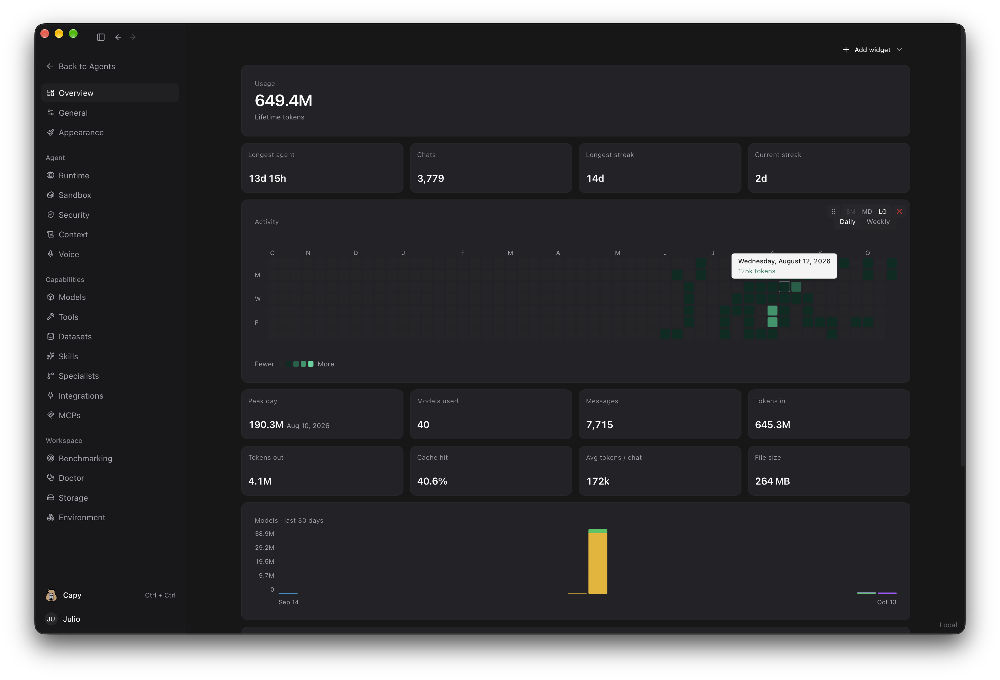
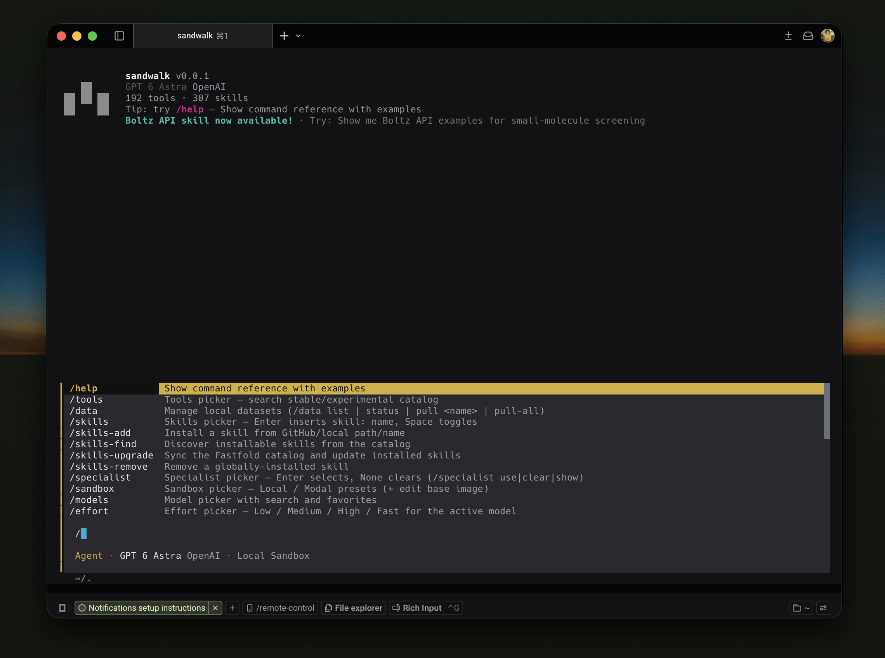

<p align="center">
  <a href="https://github.com/fastfold-ai/sandwalk"><picture>
    <source media="(prefers-color-scheme: dark)" srcset="images/sandwalk-logo-dark.svg">
    <source media="(prefers-color-scheme: light)" srcset="images/sandwalk-logo-light.svg">
    
  </picture></a>
</p>

<p align="center">
  <strong>An agent harness for ambitious work.</strong><br>
  Self-hosted. Many tools, many models, many agents at once — in one window, one terminal, one session list.
</p>

<p align="center">
  <a href="#install">Install</a> ·
  <a href="#quickstart">Quickstart</a> ·
  <a href="#features">Features</a> ·
  <a href="#models">Models</a> ·
  <a href="#cli">CLI</a> ·
  <a href="#configuration">Configuration</a> ·
  <a href="#development">Development</a> ·
  <a href="https://sandwalk.sh">sandwalk.sh</a>
</p>

<p align="center">
  
</p>

> Sandwalk is an open, self-hosted agent you run on your own compute. Point it at hard scientific research, or any ambitious work. It comes with skills, MCP servers, local and cloud models, a sandbox on your Mac or on Modal, and a grid for running several agents at once. The Mac app, the CLI, and a remote server share one session list, so you can leave a run going on a Mac mini or a cluster and pick it up from anywhere.

## Install

### macOS App

| Platform | Link |
|----------|------|
| macOS (Apple Silicon) | [Download](https://github.com/fastfold-ai/sandwalk/releases/latest/download/Sandwalk-macos-arm64.dmg) |

Drag Sandwalk to Applications and open it. The disk is signed with a Developer ID certificate. The app bundles the agent server, a Python runtime, and the dashboard, so nothing else needs to be installed. Updates arrive in-app. All builds are on [GitHub Releases](https://github.com/fastfold-ai/sandwalk/releases).

Requires macOS 12.0+ and Apple Silicon.

### CLI

```bash
curl -fsSL https://sandwalk.sh/install | bash
sandwalk setup
```

The installer puts `sandwalk` on your `PATH` with `uv`. `sandwalk setup` walks through providers, keys, and a default model. Upgrade later with `sandwalk upgrade`.

### From source

```bash
git clone https://github.com/fastfold-ai/sandwalk.git
cd sandwalk
pnpm install
cd cli && uv sync --extra all && cd ..
scripts/dev-api.sh        # agent API on :8787
scripts/dev-ui.sh         # Tauri window + Vite on :1420 (`web` for browser only)
```

See [Development](#development) for the test and packaging loop.

## Quickstart

### macOS App

The first window asks where the agent runs. **Connect locally** uses this Mac; the bundled server starts on its own. **Open remote** finds a Sandwalk server on the LAN or takes a pasted URL and API key. Under that, Recent lists every server you have opened before, with its hostname, address, and platform, so getting back onto a machine is one click.

<p align="center">
  
</p>

A new agent is one composer on an empty pane. The project scope is above it, the model is in the bar, and three chips wait underneath: **Plan** (Shift-Tab), **Skills**, and **Run in sandbox**. Type a question and send. The pane fills with the transcript; files the agent writes open beside it.

<p align="center">
  
</p>

### CLI

```bash
sandwalk                                            # interactive session
sandwalk "What is known about KRAS G12C inhibitors?" # one question, then exit
sandwalk serve                                      # the API the Mac app and remote clients talk to
```

Sessions started in the terminal show up in the Mac app, and the other way round. Both read `~/.sandwalk/`.

## Features

### Capy

Capy is a meta agent that floats over whatever you are doing. It does not take a sidebar row and it never interrupts the session underneath. Open it from the bottom of the sidebar or press **Ctrl + Ctrl** from anywhere in the app.

Capy works on Sandwalk itself rather than on your research question. Ask it to start chats and it spawns them, seeds each one with a brief, and can lay them out as a grid. Ask about state and it reads Doctor, lists Bench suites, starts a run, or pulls the last results and token use. It has its own model picker, so you can run it on something fast and cheap while the worker chats use a stronger model. Minimize it and keep talking; a badge counts replies you have not opened.

<p align="center">
  
</p>

### Grid

A group is a real grid of sessions, not a stack of tabs. Split the focused pane with **⌘D** (right) or **⇧⌘D** (down), drag the dividers, and close a cell without losing the rest. Each cell is a full session with its own transcript, model, composer, and files, and cells can come from different projects.

The grid is how you work a question from several angles at once. Give eight agents the same brief and different slices of it, or the same slice and different models, and read them side by side instead of one tab at a time. Capy can build the layout for you — ask for a 4×2 on a topic and it spawns the chats, seeds each one, and opens the split. `⌘⇧T` adds a terminal as a cell in the same grid.

<p align="center">
  
</p>

### Plan mode

Plan mode makes the agent draft before it acts. Toggle it with the **Plan** chip or Shift-Tab, or with `/plan` in the CLI. In this mode the agent does not run heavy tools; it writes a plan instead — a markdown file under `plans/` with the numbered steps, a to-do list, and a Mermaid flowchart of the workflow — and asks you the questions it needs answered before starting. The plan opens in the file pane beside the chat so you can read and edit it.

When it looks right, **Build** switches back to Agent mode and executes the plan, checking off to-dos as it goes. This is the safe way to start anything long or expensive: a screening campaign, a multi-stage analysis, a batch of jobs on a GPU.

<p align="center">
  
</p>

### Skills and MCP

Skills are instructions and scripts the agent loads on demand; MCP servers are tools it can call. The **+** button on the composer is one menu for everything a turn can use. The top rows switch between **Agent** and **Plan**. Below that: Files, Skills, MCP, Specialist, Sandbox. Pick a skill and it rides along with the message.

A **specialist** is a saved profile that pins a set of skills, MCP servers, and extra instructions for one kind of session, such as a genomics analyst or a structure-prediction profile.

<p align="center">
  
</p>

Dashboard → Skills is the manager. It lists what is installed, lets you enable or disable each skill, and filters by status, category, and author. Flip the **Skills.sh** toggle and the page becomes the public [skills.sh](https://skills.sh) leaderboard, ranked All Time, Trending (24h), or Hot, with each skill's source repo and install count. **Add skill** installs from there, from any GitHub repo, or from a local path, and the agent can do the same with `/skills-add` or by asking it to find and try a skill.

The catalog search authenticates through Vercel. Dashboard → Integrations → **Vercel** → **Add** opens a setup terminal in `~/.sandwalk/vercel-integration` and runs `vercel login`, `vercel link`, and `vercel env pull`. That saves `VERCEL_OIDC_TOKEN`, the toggle lights up, and the leaderboard loads. The dropdown next to Add takes a pasted token instead.

<p align="center">
  
</p>

MCP config is `~/.sandwalk/mcp.json`, the same shape Cursor uses. Dashboard → MCPs lists installed servers, their tool counts, and a **Connect** button for the ones that need a key.

### Sandbox

Code the agent runs goes through a sandbox. **Local Sandbox** is this machine. **Modal Sandbox** is a fresh container on Modal with CPU presets (2·8, 4·16, …) or GPU presets (T4, L4, A10, A100, H100). Pick it from the **Run in sandbox** chip, the **+** menu, or `/sandbox` in the CLI, and edit the base image inline if the default is not what you need. Files the sandbox produces land in the session workspace either way.

### Artifacts

Every session has a workspace on disk, and **Artifacts** is the view of it. Anything the agent produces lands there — whether it ran locally, in the local sandbox, or on a Modal GPU — and comes back to the same folder. Files are grouped by origin: **Your uploads**, **Generated outputs**, **Project folder**, and whatever a tool wrote. CIF and PDB render in 3D. CSV, YAML, PPTX, and PDF show a preview card. Click a file and it opens in a tab beside the chat; `@` mentions one in the composer. The workspace path is printed at the bottom so you can open it in Finder or a terminal.

Artifacts is what makes a sandbox run usable afterward. A job can execute on a remote GPU, but its structures, metrics, and reports are on your disk when it finishes, next to the conversation that produced them.

<p align="center">
  
</p>

### Structures

Structure files are first-class artifacts. CIF and PDB from a prediction or design run render in 3D in the Artifacts pane, PAE and pLDDT plots open beside them, and the chat can link each ranked candidate to its structure. The built-in `fold` and `boltz` skills submit folding, binder design, and screening jobs to FastFold and Boltz, pull the results back as artifacts, and summarize confidence metrics and a go/no-go in the transcript, so a design round is readable without leaving the window.

<p align="center">
  
</p>

### Sites

Sites turns a result into a page you can send someone. Ask for a report, a dashboard, or a landing page and the agent uses the built-in `sites-building` skill: a static site from a report shell with charts, math, Mermaid, and a theme toggle already wired in. It builds a clean `dist/`, validates it, and previews it in the right pane. When you are happy, `sites-hosting` packages that exact output and publishes it to `https://<slug>.sandwalk.site`. Publishing is a confirmed step; nothing goes public until you say so.

**Sites** in the sidebar lists everything you have built, published or not, with Preview and Open. Update a site by asking the agent to change it and publish again; the slug stays the same. Static only — HTML, CSS, client-side JavaScript, images — so a page is cheap to host and safe to share with someone who has no Sandwalk account.

<p align="center">
  
</p>

### Benchmarking

Bench runs question suites through real agent sessions, so a score reflects the whole harness — model, skills, tools, sandbox — and not just the model. Pick a suite, a model, and an optional specialist; set the sample size and how many runs go out in parallel; queue more while one is in progress. Suites in the box: MMLU, MMLU-Pro, ARC-C, MBPP, LiveCodeBench, BixBench-Verified-50, and Bio-Capybara-full, with cached questions so repeat runs start fast.

Results keep every run with its score, duration, correct count, provider, token use, and date, filterable by suite, status, and provider. **Compare** puts two runs side by side to see where one model or specialist beats another. LLM judges score open-ended answers. Bench sessions stay off the chat list. The same suites run headlessly from the terminal with `sandwalk eval`, which is how we gate releases.

<p align="center">
  
</p>

### Overview

Dashboard Overview is the usage board for this server. Widgets cover lifetime tokens, tokens in and out, cache hit rate, the longest agent run, chat and message counts, streaks, an activity heatmap by day, and a 30-day chart of which models you actually ran. **Add widget** adds, removes, and rearranges them, and the layout persists. Project Home has the same board scoped to one project, with its library size and description alongside.

<p align="center">
  
</p>

### Remote sessions

Run `sandwalk serve` on a Mac mini or a cluster node and open it from your laptop. The Mac app and the CLI both take a URL and an API key. The session list you see is the one on that server, so a long run keeps going after you close the lid. `sandwalk auth` manages the key.

### Science toolkit

Live databases are tools the agent can call: PubChem, ChEMBL, UniProt, PDB, Open Targets, ClinicalTrials.gov, and others. Optional local corpora install with `sandwalk data pull-all` (DepMap, MSigDB, STRING). `sandwalk tool list` shows what is loaded. The toolkit is a starting point, not the ceiling; skills and MCP servers extend it to any domain.

## Models

Dashboard → Models lists every provider in a grid with a Connected or Not set up badge. Keys stay on this computer. Connected providers show up in the composer picker; the composer shows the model, effort, and how much of the context window the turn is using.

<p align="center">
  
</p>

| Kind | Providers |
|------|-----------|
| Cloud | OpenAI, Claude (Anthropic), Gemini (Google), xAI, Kimi (Moonshot), NVIDIA, OpenCode Zen, DeepSeek, MiniMax, Mistral, Qwen Cloud, Together AI, OpenRouter, Cerebras, Groq, Fireworks AI, Amazon Bedrock |
| Local | Ollama, oMLX, Unsloth, DS4, llama.cpp, LM Studio, any OpenAI-compatible endpoint |

Local endpoints are discovered from `/v1/models` or Ollama's `/api/tags`. Add one with **Add Local LLM**, or in the CLI with `/model-manager`.

## CLI

`sandwalk` is the same agent in a terminal. Run it two ways:

- **Standalone.** Open Terminal, iTerm, Warp, or whatever you use, and type `sandwalk`. The banner reports the model, the provider, and how many tools and skills are loaded.
- **Inside the app.** Press **⌘⇧T** or pick **Terminal** on a blank pane and a terminal opens as a cell in the grid next to your chats. Type `sandwalk` there and it is the same session list, the same `~/.sandwalk/`, the same artifacts; a run started in that pane is a session in the sidebar.

Either way, typing `/` opens the command list with inline descriptions. `/help` shows the full reference with examples. The status line at the bottom reports the mode, model, provider, sandbox, and context use.

<p align="center">
  
</p>

<p align="center">
  
</p>

### Commands

```bash
sandwalk setup                    # providers, keys, default model
sandwalk                          # interactive session
sandwalk "question"               # one-shot
sandwalk serve                    # local agent API on :8787
sandwalk serve --host 0.0.0.0     # expose to the LAN (needs sandwalk auth)
sandwalk auth                     # manage the API key for serve
sandwalk doctor                   # environment and configuration checks
sandwalk eval                     # run Bench suites headlessly
sandwalk skills add fastfold-ai/skills
sandwalk mcp list
sandwalk sandbox status           # Local Sandbox or Modal Sandbox
sandwalk data pull-all            # DepMap, MSigDB, STRING
sandwalk tool list
sandwalk upgrade
```

### Slash commands

| Command | What it does |
|---------|--------------|
| `/models`, `/effort` | Switch the model; set Low / Medium / High / Fast for models with thinking controls |
| `/plan` | Toggle Plan mode. Writes `plans/*.md` until you switch back to Agent |
| `/sandbox` | Pick Local or a Modal CPU/GPU preset; edit the base image inline |
| `/specialist` | Use, clear, or list specialists |
| `/skills`, `/skills-add`, `/skills-find` | Loaded skills; install from GitHub or a path; search the catalog |
| `/mcps` | Connect, enable, validate, add, or remove MCP servers |
| `/tools`, `/data` | Tool status; local datasets |
| `/usage`, `/compact` | Token and cost for the session; compress context |
| `/sessions`, `/resume`, `/new` | List, resume, or start sessions |
| `/export`, `/notebook` | Transcript to markdown; session to `.ipynb` |
| `/agents` | Run a question across N parallel agents |
| `/doctor` | Readiness diagnostics with fix hints |

`Enter` submits, `Ctrl+J` inserts a newline, paste an image to attach it, `Ctrl+C` interrupts. Full reference: [`cli/README.md`](cli/README.md).

## Configuration

Everything lives under `~/.sandwalk/`:

| Path | Contents |
|------|----------|
| `config.json` | Providers, keys, default model, sandbox preferences |
| `mcp.json` | MCP servers, Cursor-compatible |
| `skills/` | Installed skills |
| `workspaces/<session>/` | Per-session artifacts: `uploads/`, `outputs/`, `plans/`, `project/` |
| `data/` | Local datasets from `sandwalk data pull` |
| `agent-server.db` | Sessions, shared by the CLI and the app |

The Mac app stores its own window and server settings in `~/Library/Application Support/Sandwalk/`. `sandwalk config show` prints the active configuration; `sandwalk config set <key> <value>` changes one key.

Provider keys can also come from the environment (`OPENAI_API_KEY`, `ANTHROPIC_API_KEY`, `OPENROUTER_API_KEY`, `MOONSHOT_API_KEY`, and so on). Modal needs `MODAL_TOKEN_ID` and `MODAL_TOKEN_SECRET`, or run `modal setup`.

## Development

Monorepo:

| Directory | Contents |
|-----------|----------|
| `cli/` | Python agent, tools, skills, and the FastAPI server |
| `apps/local-web/` | React dashboard and the Tauri shell |
| `apps/sandwalk-mac/` | Swift menubar helper that supervises the server |
| `apps/packaging/` | Signed DMG, notarization, updater artifacts |
| `docs/` | Product docs site (`pnpm dev:docs`) |

```bash
scripts/verify.sh         # typecheck, lint, build, unit tests + coverage gates (web + cli) — the CI gate
scripts/verify.sh e2e     # Playwright: grid, terminals, PTY round-trip
pnpm e2e:bench            # perf report → apps/local-web/e2e/results/grid-latest.json
./apps/packaging/package-macos-dmg.sh    # signed DMG; INSTALL=1 copies it to ~/Applications
```

Working with an AI agent? [AGENTS.md](AGENTS.md) and the project skills in `.cursor/skills/` encode the dev and test loop. See [CONTRIBUTING.md](CONTRIBUTING.md), [.github/TESTING.md](.github/TESTING.md), and [apps/packaging/APPLE-SIGNING.md](apps/packaging/APPLE-SIGNING.md).

## License

[Apache License 2.0](LICENSE). Copyright © 2026 Fastfold AI Labs.
