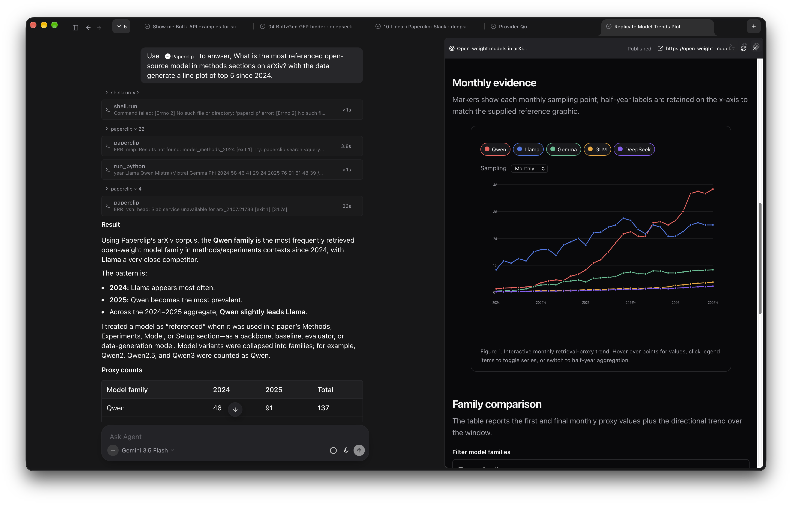

<p align="center">
  <a href="https://github.com/fastfold-ai/sandwalk"><picture>
    <source media="(prefers-color-scheme: dark)" srcset="images/sandwalk-logo-dark.svg">
    <source media="(prefers-color-scheme: light)" srcset="images/sandwalk-logo-light.svg">
    
  </picture></a>
</p>
<p align="center">
  <small>An agent harness for ambitious work.</small>
</p>

<p align="center">
  <a href="#get-started">Get started</a> ·
  <a href="#quickstart">Quickstart</a> ·
  <a href="#features">Features</a> ·
  <a href="#capy">Capy</a> ·
  <a href="#cli">CLI</a> ·
  <a href="#documentation">Docs</a>
</p>

<p align="center">
  
</p>

> Sandwalk is an open, self-hosted agent you run on your own compute. Direct it toward hard scientific research, or any ambitious work. Chat, CLI, and the macOS app share the same sessions. Leave one running on a Mac Mini or a cluster and open it from wherever you are.

## Get started

Download the native Sandwalk app for your operating system:

| Platform | Link |
|----------|------|
| macOS (Apple Silicon) | [Download](https://github.com/fastfold-ai/sandwalk/releases/latest/download/Sandwalk-macos-arm64.dmg) |

Download from [GitHub Releases](https://github.com/fastfold-ai/sandwalk/releases).

Or if you prefer to install the CLI:

```bash
curl -fsSL https://sandwalk.sh/install | bash
```

## Quickstart

### Connect

The first window asks where the agent runs. **Connect locally** uses this Mac. **Open remote** finds a Sandwalk server on the LAN or takes a pasted URL. Under that, Recent lists servers you have opened before — the MacBook, a Mac mini on `192.168.2.178`, a Linux box called `ai-server` — so getting back onto a machine is one click.

<p align="center">
  
</p>

### New agent

A fresh agent is one composer on an empty pane. The project scope sits above it (here, All), the model is in the bar (GPT-6 Astra), and three chips wait underneath: **Plan** (Shift-Tab), **Skills**, and **Run in sandbox**. Type and send; the pane fills with the transcript.

<p align="center">
  
</p>

```bash
sandwalk setup
sandwalk
sandwalk "What is known about KRAS G12C inhibitors?"
```

## Features

Agents run on your machine or in the cloud. Chat, CLI, and the Mac app share one session list.

### Capy

Capy is a floating panel over whatever session is open. In this shot the chat behind it just ran `nvidia-smi` in a Modal sandbox and printed a Tesla T4 table. Capy sits on top with its own model (DeepSeek V4 Flash) and four starter prompts: start a 4×2 research grid, run doctor, list bench suites, show the last bench results. Open it from the bottom of the sidebar or with **Ctrl + Ctrl**.

<p align="center">
  
</p>

### Grid

Ask Capy for a grid and it spawns the chats and lays them out. Here it was told to start a 4×2 grid on the latest in protein design. The panel on the right shows the `capy.spawn_sessions` call and its reply: eight worker chats, four across by two down, each seeded with the same brief. Every cell is a full session with its own stream and composer; `Protein Design 2` is mid-search while others are already summarizing RFdiffusion, AlphaFold 3, and validation bottlenecks.

<p align="center">
  
</p>

### Plan mode

With the gold **Plan** chip on, the agent writes a plan before it does anything. The user asked for a small-molecule screening campaign in Boltz. On the left the chat shows the plan card, a to-do, and the agent asking which target and library to use. On the right the file pane holds `boltz_screening_campaign.md` with the step list and a Mermaid flowchart from User Query down to Done. **Build** at the top right runs the plan.

<p align="center">
  
</p>

### Skills and MCPs

The **+** button opens one menu for everything a turn can use. Top rows switch between **Agent** and **Plan**. Below that: Files, Skills, MCP, Specialist, Sandbox. Skills is open here, and the flyout lists what is installed — boltz, convert-documents-to-markdown, diagrams_mermaid, fold, md_openmm_calvados. Pick one and it rides along with the message. Skills install from GitHub or [skills.sh](https://skills.sh); MCP config is `~/.sandwalk/mcp.json`.

<p align="center">
  
</p>

### Skills manager and skills.sh

Dashboard → Skills is where you manage the catalog. Flip the **Skills.sh** toggle in the search bar and the page becomes the public [skills.sh](https://skills.sh) leaderboard — 1.3 million installs, ranked All Time, Trending (24h), or Hot. Each row is a skill, its source repo, install count, and a **View** link. `find-skills` from vercel-labs sits at the top; Matt Pocock's `grill-me`, `tdd`, and `handoff` follow. **Add skill** installs from here, from GitHub, or from a local path.

The catalog search is authenticated through Vercel. Dashboard → Integrations → **Vercel** has an **Add** button that opens a setup terminal in `~/.sandwalk/vercel-integration` and runs `vercel login`, `vercel link`, and `vercel env pull`. That pulls an OIDC token and saves it as `VERCEL_OIDC_TOKEN`. Once it is set, the skills.sh toggle lights up and the leaderboard loads. There is also a manual path: paste the token into **Add Vercel OIDC** from the dropdown next to Add.

<p align="center">
  
</p>

### CLI

The same agent runs in a terminal, including a terminal pane inside the app. The banner reports the model, 192 tools, and 307 skills. Typing `/` opens the command list: `/tools`, `/data`, `/skills`, `/skills-add`, `/specialist`, `/sandbox`, `/models`, `/effort`. The status line at the bottom shows the active model, provider, sandbox, and context use.

<p align="center">
  
</p>

### Benchmarking

Bench runs suites through real agent sessions. The Results tab here has 128 runs, filterable by suite, status, and provider. The suite picker lists MMLU, MMLU-Pro, ARC-C, MBPP, LiveCodeBench, BixBench-Verified-50, and Bio-Capybara-full. Each row carries the model, score, duration, correct count, provider, token use, and date. **Compare** puts two runs side by side.

<p align="center">
  
</p>

### Overview

Dashboard Overview is the usage board. Big number at the top is lifetime tokens (649.4M). Cards cover the longest agent run, chat count, and streaks. The heatmap shows activity by day, with a tooltip on August 12. Lower cards track peak day, models used, messages, tokens in and out, and cache hit rate. A 30-day model chart sits at the bottom. **Add widget** rearranges the board.

<p align="center">
  
</p>

### Models

Dashboard → Models lists every provider in a grid with a Connected or Not set up badge. Cloud covers OpenAI, Claude, Gemini, xAI, Kimi, NVIDIA, OpenCode Zen, DeepSeek, MiniMax, Mistral, Qwen Cloud, Together AI, OpenRouter, Cerebras, Groq, Fireworks AI, and Amazon Bedrock. Local lists discovered endpoints such as Ollama, oMLX, and Unsloth, with their reachability. Keys stay on this computer, and connected providers show up in the composer picker.

<p align="center">
  
</p>

### Files beside the chat

The right pane is the session workspace. This chat ran a binder design and the agent wrote a Go/No-Go assessment with iPTM, pTM, and PAE in a table. On the right the Artifacts view shows what it produced: `workflow.yml`, `gfp_binder.yaml`, a rendered `1ema.cif` structure, a PowerPoint, and a CSV of lysozyme variants. The chat and its files stay open together.

<p align="center">
  
</p>

### Plots

A published page renders in that same pane. The user asked for the most-referenced open-weight model on arXiv since 2024, using the Paperclip MCP, with a line plot of the top five. The chat on the left shows the tool calls and the Result; the right side is the live page: a monthly line chart for Qwen, Llama, Gemma, GLM, and DeepSeek, with a sampling control and a family comparison table below.

<p align="center">
  
</p>

### Structures

A BoltzGen GFP binder run. The chat ranks the designed sequences and links each candidate to its structure, then gives a Go/no-go: the workflow completed, but interface confidence is too weak for immediate biological interpretation. On the right the Artifacts pane renders `rank1_2.cif` and `rank2_0.cif` as 3D structures next to the metrics CSVs and a results overview PDF.

<p align="center">
  
</p>

### Science toolkit

Live databases (PubChem, ChEMBL, UniProt, PDB, Open Targets, ClinicalTrials.gov, and others) are tools the agent can call. Optional local corpora install with `sandwalk data pull-all`. Sandbox runs stay on this machine, or go to Modal when you want a clean GPU box.

## CLI

A fully featured TUI for people who prefer the terminal. Same sessions as the Mac app.

```bash
sandwalk setup
sandwalk
sandwalk serve
sandwalk eval
sandwalk skills add fastfold-ai/skills
sandwalk --help
```

Interactive: `/model`, `/sandbox`, `/plan`, `/usage`. Full reference: [`cli/README.md`](cli/README.md).

Config lives under `~/.sandwalk/`.

## Documentation

Product docs: [`docs/`](docs/) (`pnpm dev:docs`). Site: [sandwalk.sh](https://sandwalk.sh).

## Contributing

Monorepo: `cli/`, `apps/local-web/`, `apps/sandwalk-mac/`, `apps/packaging/`. See [CONTRIBUTING.md](CONTRIBUTING.md).

```bash
git clone https://github.com/fastfold-ai/sandwalk.git
cd sandwalk
pnpm install
cd cli && uv sync --extra dev && cd ..
scripts/dev-api.sh        # agent API from this checkout on :8787
scripts/dev-ui.sh         # another terminal: Tauri window + Vite :1420 (`web` for browser only)
```

Testing mirrors CI in one command, plus a Playwright harness for the split
grid / terminals and perf benchmarks with before/after comparison:

```bash
scripts/verify.sh         # typecheck, lint, build, unit tests + coverage gates (web + cli)
pnpm e2e                  # grid + terminal e2e against your running API
pnpm e2e:bench            # perf report → apps/local-web/e2e/results/grid-latest.json
pnpm e2e:compare apps/local-web/e2e/results/grid-baseline.json apps/local-web/e2e/results/grid-latest.json
```

Working with an AI agent? [AGENTS.md](AGENTS.md) and the project skills in
`.cursor/skills/` (`sandwalk-dev-loop`, `sandwalk-testing`) encode the dev and
test cycle; [.github/TESTING.md](.github/TESTING.md) has the details.

## License

[Apache License 2.0](LICENSE). Copyright © 2026 Fastfold AI Labs.
