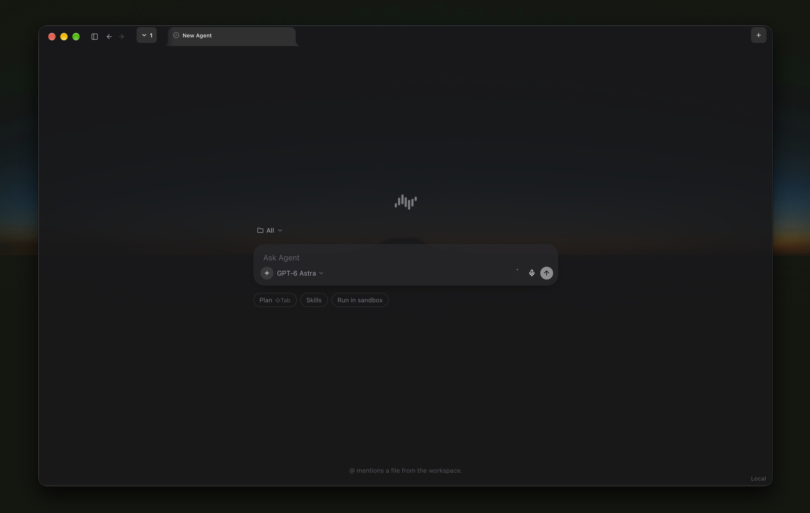

<p align="center">
  <a href="https://github.com/fastfold-ai/sandwalk"><picture>
    <source media="(prefers-color-scheme: dark)" srcset="images/sandwalk-logo-dark.svg">
    <source media="(prefers-color-scheme: light)" srcset="images/sandwalk-logo-light.svg">
    
  </picture></a>
</p>
<p align="center">
  <small>An agent harness for ambitious work.</small>
</p>

<p align="center">
  <a href="#get-started">Get started</a> ·
  <a href="#quickstart">Quickstart</a> ·
  <a href="#features">Features</a> ·
  <a href="#capy">Capy</a> ·
  <a href="#cli">CLI</a> ·
  <a href="#documentation">Docs</a>
</p>

<p align="center">
  
</p>

> Sandwalk is an open, self-hosted agent you run on your own compute. Direct it toward hard scientific research, or any ambitious work. Chat, CLI, and the macOS app share the same sessions. Leave one running on a Mac Mini or a cluster and open it from wherever you are.

The composer is the front door. One question can reach a model, a skill, an MCP server, a sandbox, and the files in the workspace — then a grid of agents can work the same problem side by side. Sandwalk is there so ambitious research is not stuck in a single chat.

<p align="center">
  
</p>

## Get started

Download the native Sandwalk app for your operating system:

| Platform | Link |
|----------|------|
| macOS (Apple Silicon) | [Download](https://github.com/fastfold-ai/sandwalk/releases/latest/download/Sandwalk-macos-arm64.dmg) |

Download from [GitHub Releases](https://github.com/fastfold-ai/sandwalk/releases).

Or if you prefer to install the CLI:

```bash
curl -fsSL https://sandwalk.sh/install | bash
```

## Quickstart

### Connect

Launch Sandwalk from Applications. **Connect locally** uses the agent on this Mac. **Open remote** reaches one already running on another machine, by LAN scan or a pasted URL. Recent servers stay in the list.

<p align="center">
  
</p>

```bash
sandwalk setup
sandwalk
sandwalk "What is known about KRAS G12C inhibitors?"
```

## Features

Agents run on your machine or in the cloud. Chat, CLI, and the Mac app share one session list.

### Capy

Capy is the overlay agent. It is not a row in the sidebar. Open it from the bottom of the sidebar, or press **Ctrl + Ctrl**. It starts chats, opens splits, and can reach Bench, skills, and MCP servers while a normal session stays on screen behind it.

<p align="center">
  
</p>

### Grid

A group is a real grid, not a stack of tabs. Capy can open one for you — for example a 4×2 of chats each researching a slice of protein design — and every cell keeps its own composer, model, and stream. **⌘D** splits right, **⇧⌘D** splits down.

### Plan mode

Plan mode drafts before it edits. The Plan chip (Shift-Tab) switches the composer. The agent writes a plan with todos, then a Mermaid flowchart of the workflow sits in the file pane next to the chat. **Build** runs that plan.

<p align="center">
  
</p>

### Skills and MCPs

The **+** menu is how you attach what the turn can use: Agent or Plan, files, skills, MCP servers, a specialist, or a sandbox. Skills install from GitHub or [skills.sh](https://skills.sh). MCP config is `~/.sandwalk/mcp.json`.

<p align="center">
  
</p>

### CLI

`sandwalk` is the same product in a terminal. `/help` lists the pickers: tools, datasets, skills, sandbox, specialist, models, and effort. `sandwalk serve` is the local API the Mac app talks to.

<p align="center">
  
</p>

### Benchmarking

Bench runs question suites through real sessions. Filter by suite, status, and provider, then read the score, duration, and token use for each run. Compare models on the same suite. From the CLI: `sandwalk eval`.

<p align="center">
  
</p>

### Projects and overview

Dashboard Overview is the usage board: lifetime tokens, streaks, an activity heatmap, and which models you actually ran. Widgets can be rearranged. Projects group the chats underneath that.

<p align="center">
  
</p>

### Models

Dashboard → Models is where provider keys live. Cloud models (OpenAI, Claude, Gemini, OpenRouter, and others) and local endpoints (Ollama, Unsloth, oMLX) show up in the composer once they connect. Keys stay on this computer.

<p align="center">
  
</p>

### Files beside the chat

The right pane is the workspace for the session: files the agent wrote, a preview, and artifacts. A structure, a metrics table, and the chat that produced them stay open together.

<p align="center">
  
</p>

### Plots

Figures render in that same pane. A line chart, a sampling control, and the prompt that asked for it sit next to the transcript instead of in a separate viewer.

<p align="center">
  
</p>

### Structures

CIF and PDB from a design run open as 3D in the artifact list. Ranked candidates, metrics, and the Go / No-Go note stay in the chat on the left.

<p align="center">
  
</p>

<p align="center">
  
</p>

### Science toolkit

Live databases (PubChem, ChEMBL, UniProt, PDB, Open Targets, ClinicalTrials.gov, and others) are tools the agent can call. Optional local corpora install with `sandwalk data pull-all`. Sandbox runs stay on this machine, or go to Modal when you want a clean GPU box.

## CLI

A fully featured TUI for people who prefer the terminal. Same sessions as the Mac app.

```bash
sandwalk setup
sandwalk
sandwalk serve
sandwalk eval
sandwalk skills add fastfold-ai/skills
sandwalk --help
```

Interactive: `/model`, `/sandbox`, `/plan`, `/usage`. Full reference: [`cli/README.md`](cli/README.md).

Config lives under `~/.sandwalk/`.

## Documentation

Product docs: [`docs/`](docs/) (`pnpm dev:docs`). Site: [sandwalk.sh](https://sandwalk.sh).

## Contributing

Monorepo: `cli/`, `apps/local-web/`, `apps/sandwalk-mac/`, `apps/packaging/`. See [CONTRIBUTING.md](CONTRIBUTING.md).

```bash
git clone https://github.com/fastfold-ai/sandwalk.git
cd sandwalk
pnpm install
cd cli && uv sync --extra dev && cd ..
scripts/dev-api.sh        # agent API from this checkout on :8787
scripts/dev-ui.sh         # another terminal: Tauri window + Vite :1420 (`web` for browser only)
```

Testing mirrors CI in one command, plus a Playwright harness for the split
grid / terminals and perf benchmarks with before/after comparison:

```bash
scripts/verify.sh         # typecheck, lint, build, unit tests + coverage gates (web + cli)
pnpm e2e                  # grid + terminal e2e against your running API
pnpm e2e:bench            # perf report → apps/local-web/e2e/results/grid-latest.json
pnpm e2e:compare apps/local-web/e2e/results/grid-baseline.json apps/local-web/e2e/results/grid-latest.json
```

Working with an AI agent? [AGENTS.md](AGENTS.md) and the project skills in
`.cursor/skills/` (`sandwalk-dev-loop`, `sandwalk-testing`) encode the dev and
test cycle; [.github/TESTING.md](.github/TESTING.md) has the details.

## License

[Apache License 2.0](LICENSE). Copyright © 2026 Fastfold AI Labs.
