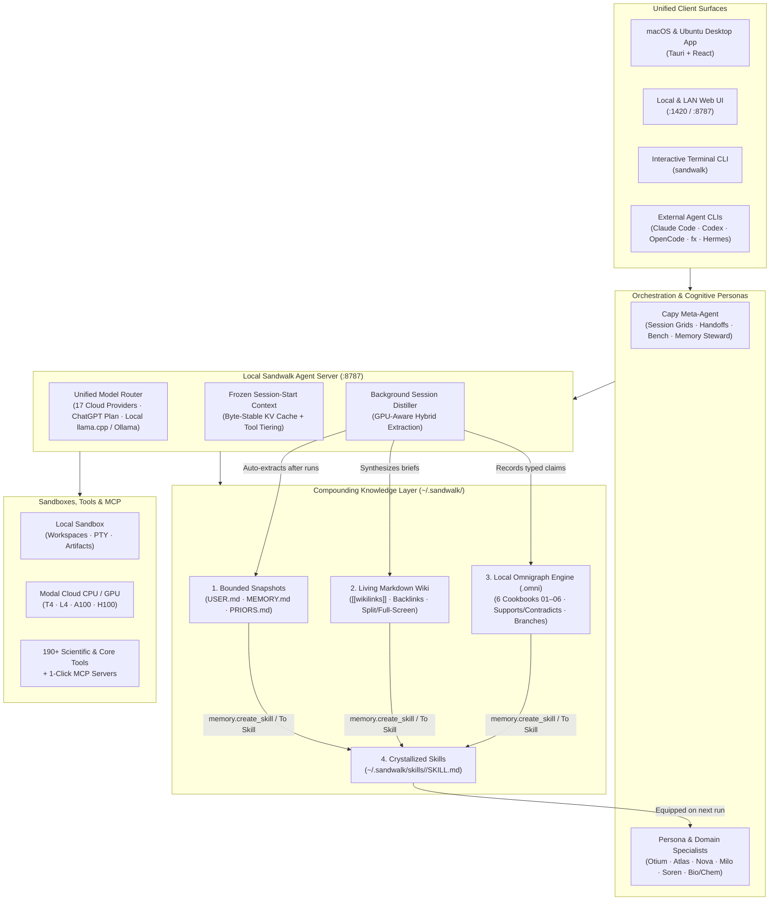

<p align="center">
  <a href="https://github.com/fastfold-ai/sandwalk"><picture>
    <source media="(prefers-color-scheme: dark)" srcset="images/sandwalk-logo-dark.svg">
    <source media="(prefers-color-scheme: light)" srcset="images/sandwalk-logo-light.svg">
    
  </picture></a>
</p>

<p align="center">
  <strong>An agent harness for ambitious work.</strong>
</p>

<p align="center">
  <a href="#install">Install</a> ·
  <a href="#philosophy--architecture">Philosophy & Architecture</a> ·
  <a href="#compounding-memory-wiki--omnigraph">Memory & Omnigraph</a> ·
  <a href="#models">Models</a> ·
  <a href="#cli">CLI</a> ·
  <a href="#configuration">Configuration</a> ·
  <a href="#development">Development</a> ·
  <a href="https://sandwalk.sh">sandwalk.sh</a>
</p>

<p align="center">
  <a href="https://github.com/fastfold-ai/sandwalk/actions/workflows/ci.yml"></a>
  <a href="https://app.codecov.io/gh/fastfold-ai/sandwalk"></a>
</p>

<p align="center">
  
</p>

## Install

### Desktop

| Platform | Link |
|----------|------|
| macOS (Apple Silicon) | [Download](https://github.com/fastfold-ai/sandwalk/releases/latest/download/Sandwalk-macos-arm64.dmg) |
| Ubuntu amd64 | [Download](https://github.com/fastfold-ai/sandwalk/releases/latest/download/Sandwalk_0.1.10_amd64.deb) |
| Ubuntu arm64 | [Download](https://github.com/fastfold-ai/sandwalk/releases/latest/download/Sandwalk_0.1.10_arm64.deb) |

macOS needs 12.0 or newer and Apple Silicon. Open the disk image and drag Sandwalk to Applications.

On Ubuntu 24.04 or 26.04, add the repository and install:

```bash
curl -fsSL https://apt.sandwalk.sh/sandwalk.gpg | sudo gpg --dearmor -o /usr/share/keyrings/sandwalk.gpg
echo "deb [arch=amd64,arm64 signed-by=/usr/share/keyrings/sandwalk.gpg] https://apt.sandwalk.sh stable main" | sudo tee /etc/apt/sources.list.d/sandwalk.list
sudo apt update
sudo apt install sandwalk
```

Or download the `.deb` from the table and run `sudo apt install ./Sandwalk_*.deb`. Installing the CLI first and running `sandwalk desktop` does the same download for this computer's architecture.

### CLI

```bash
curl -fsSL https://sandwalk.sh/install.sh | bash
sandwalk setup
sandwalk desktop
```

The installer detects macOS or Linux, installs `uv` if it is missing, and puts `sandwalk` on your `PATH`. `sandwalk setup` walks through providers, keys, and a default model. `sandwalk desktop` installs the desktop app from the latest release. Upgrade the CLI later with `sandwalk upgrade`.

### From source

```bash
git clone https://github.com/fastfold-ai/sandwalk.git
cd sandwalk
pnpm install
cd cli && uv sync --extra all && cd ..
scripts/dev-api.sh        # agent API on :8787
scripts/dev-ui.sh         # Tauri window + Vite on :1420 (`web` for browser only)
```

See [Development](#development) for the test and packaging loop.

## Why Sandwalk exists

Sandwalk exists to turn individual curiosity into collective discovery.

It is built for scientists, engineers, and anyone chasing a question that takes days, not one prompt.

Serious research cannot live inside one vendor's model, one set of tools, or one cloud. The model, the skills, the MCP servers, the personas, the memory, and the compute are separate pieces in Sandwalk, so a session can pair any of them and swap any of them as the field moves. The harness is open, self-hosted, and Apache-2.0. The work stays on the machine that ran it, and a crystallized skill or a published page is how a result is shared.

Sandwalk is in developer preview.

## Philosophy & Architecture

Most AI chat tools treat every conversation as disposable: when a thread ends, the context, caveats, negative results, and domain workflows vanish with it. Dumping raw transcripts into a vector store or an ever-growing system prompt only trades amnesia for context rot and broken KV caches.

Sandwalk is built around four core principles:

1. **Decoupled & Local-First (`~/.sandwalk/`)**: Your models (17 cloud providers + local `llama.cpp`, Ollama, oMLX, LM Studio), your execution sandboxes (Local machine or Modal cloud CPU/GPU), your MCP servers, and your knowledge live on your machine in open formats (`.md`, `.pg`, `.gq`, `.jsonl`, Lance `.omni`, SQLite).
2. **Cognitive Diversity via Persona Specialists**: Complex questions benefit from distinct thinking styles. Sandwalk ships with O'Reilly-style natural history animal personas—**Otium** (*Relaxed* Capybara), **Atlas** (*Ambitious Generalist* Wolf), **Nova** (*Dreamer* Fox), **Milo** (*Project Manager* Badger), and **Soren** (*Skeptical Reviewer* Owl)—alongside domain specialists. Each persona carries its own cognitive priors (`PRIORS.md`), learned memory (`MEMORY.md`), default model, and ontology lens.
3. **Byte-Stable Prompt Prefix + Progressive Disclosure**: At session start, Sandwalk injects a compact, bounded snapshot (`USER.md` ~1,375 chars + `MEMORY.md` ~2,200 chars + `PRIORS.md` + Living Wiki TOC + Active Ontology summary) and freezes it for the session so LLM KV prefix caches stay warm. Deeper knowledge is retrieved on demand via tools.
4. **Compounding Knowledge into Reusable Skills**: As you work with your agents or **Capy**, conversations automatically distill into **4 governed knowledge assets**—**Bounded Memories**, **Living Markdown Wiki**, **Versioned Omnigraph Knowledge Graph**, and **Reusable Skills (`SKILL.md`)**—so what you learn today becomes an executable capability tomorrow.



## Compounding Memory, Wiki & Omnigraph

Sandwalk turns everyday agent sessions into a structured, self-improving knowledge base—without requiring external database infrastructure:

```mermaid
flowchart LR
    Chat["Agent / Persona Session\n(or Capy Command)"] -->|1. During turn| Tools["Core Memory Tools\n(memory.mutate · wiki.write · graph.record_claim)"]
    Chat -->|2. On run.completed| AutoDistill["Background Distiller\n(_auto_distill_after_run)"]

    Tools & AutoDistill --> M["Memories\nUSER.md & MEMORY.md"]
    Tools & AutoDistill --> W["Living Wiki\n~/.sandwalk/memory/wiki/*.md"]
    Tools & AutoDistill --> G["Omnigraph (.omni)\nschema.pg · queries.gq · data.jsonl"]

    G -->|Git-style review/* branch| Review["Supports vs. Contradicts\n& Contested Claim Alerts"]
    M & W & G -->|3. Crystallize\n(memory.create_skill / UI)| Skill["Installed Sandwalk Skill\n~/.sandwalk/skills/<slug>/SKILL.md"]
    Skill -->|4. /skill-slug| Chat
```

- **Four Scopes**: `global` (Personal & Lab Second Brain), `project:<id>` (per-project rules and wiki), `specialist:<id>` (each persona's private brain), and `user` (`USER.md` profile).
- **Six Runnable Omnigraph Cookbook Modes (`01–06`)**: Powered by the local [Omnigraph](https://www.omnigraph.dev/) Rust + Lance engine (`~/.sandwalk/bin/omnigraph` + auto-enabled stdio MCP bridge):
  - `01 Industry intel` — Track market signals through the SPIKE frame (`Signal`, `Pattern`, `Insight`, `KnowHow`).
  - `02 Pharma intel` — Monitor compounds, mechanisms, clinical trials, and competitive assumptions.
  - `03 Context graph` — Model organizational decisions, traces, actors, and action items.
  - `04 VC OS` — Connect deal flow, investment beliefs, founders, and portfolio signals.
  - `05 Biomed research` — Track targets, papers, assays, hypotheses, and supporting vs. contradicting evidence.
  - `06 Second brain` — Personal operating graph for people, organizations, notes, goals, projects, and tasks (default for Global Brain).
- **Crystallize Knowledge into Skills (`Create Skill` / `memory.create_skill`)**: Turn any scope's curated `MEMORY.md` rules, Living Wiki pages (`[[wikilinks]]`), and Omnigraph `.pg` ontology + `.gq` stored queries into a reusable Sandwalk Skill (`~/.sandwalk/skills/<slug>/SKILL.md` + `references/{schema.pg,queries.gq,wiki-digest.md}`) in one click—or ask any agent or Capy to build it for you.

## What Sandwalk does

- **Shares one session list across the app, the CLI, and remote devices.** Start a session in the terminal, continue it in the Mac or Ubuntu app, or check on it from a phone.
- **Runs on any LLM, cloud or local.** OpenAI, Anthropic, Gemini, xAI, DeepSeek, OpenRouter, Bedrock, or a local model on Ollama, oMLX, llama.cpp, or LM Studio. Sign in with ChatGPT to run OpenAI models on a Plus or Pro plan instead of an API key.
- **Works with the other coding agents you already use.** Open Claude Code, Codex, OpenCode, or fx in a Sandwalk terminal; the tab shows which one is running. Import any of their sessions as a Sandwalk chat, or hand a Sandwalk chat to them. Claude Code and Codex can resume it as native history.
- **Includes Capy, a meta agent for the workspace.** Aware of your active sessions and knowledge base, Capy spawns new sessions (including multi-persona grids like `"Nova,Soren"`), seeds them with briefs, manages memories/wiki/graph, crystallizes skills, and runs benchmarks or diagnostics on command.
- **Compounds knowledge across sessions with Memory, Living Wiki & Omnigraph.** Bounded `USER.md`/`MEMORY.md` snapshots, a full-screen Markdown Wiki with live preview and `[[wikilinks]]`, and a local Lance-backed Omnigraph with 6 Cookbook Modes (`01–06`), `Supports`/`Contradicts` provenance edges, and Git-style branches.
- **Installs skills in one click from skills.sh—or crystallizes your own.** Pull from the public catalog, a GitHub repo, or a local folder, or convert your own Wiki and Ontology into a reusable `/skill`.
- **Bundles personas and workflows into Specialists.** Choose from O'Reilly-style woodcut animal personas (**Otium**, **Atlas**, **Nova**, **Milo**, **Soren**) or domain specialists, each with its own cognitive priors (`PRIORS.md`), model, and specialist brain.
- **Organizes long-horizon work into Projects.** Scope sessions, shared library files, custom instructions, Living Wiki pages, and usage boards per project.
- **Executes code locally or on cloud GPUs.** Run in a local sandbox or a Modal container, and every file, plot, report, notebook (`.ipynb`), or 3D output lands beside the session.
- **Measures the whole harness with built-in Benchmarking.** In science and ambitious work, changing a model, a skill, or a prompt should be tested, not guessed. Run MMLU, MMLU-Pro, ARC-C, MBPP, LiveCodeBench, BixBench, or Bio-Capybara through real agent sessions, compare two runs side by side across models or Specialists, or gate changes from the CLI with `sandwalk eval`.
- **Ships with a scientific toolkit and local corpora.** Query PubChem, ChEMBL, UniProt, PDB, Open Targets, and ClinicalTrials.gov out of the box, or pull local datasets (DepMap, MSigDB, STRING).
- **Scales from one plan to a grid of agents.** Draft a plan before a long run, split a question across parallel sessions, talk to Capy hands-free with local voice, and publish the result as a static site at `sandwalk.site`.

## Features

<table>
<tr>
<td width="50%" valign="top">
<br>
<sub><strong>Sandwalk runs locally by default.</strong> Or it opens a server that is already running.</sub>
</td>
<td width="50%" valign="top">
<br>
<sub><strong>The composer is where a session starts.</strong> The model, Plan, Skills, and the sandbox are already on it.</sub>
</td>
</tr>
<tr>
<td width="50%" valign="top">
<br>
<sub><strong>Capy works on Sandwalk.</strong> It starts sessions, lays out a grid, and reads evals.</sub>
</td>
<td width="50%" valign="top">
<br>
<sub><strong>Several agents, one question.</strong> Same brief, different slices.</sub>
</td>
</tr>
<tr>
<td colspan="2" valign="top">
<br>
<sub><strong>A session can start with a plan.</strong> Steps and a flowchart. Build runs them.</sub>
</td>
</tr>
<tr>
<td width="50%" valign="top">
<br>
<sub><strong>Persona Specialists think differently.</strong> Otium, Soren, Milo, Nova, and Atlas—each with its own priors, model, and brain.</sub>
</td>
<td width="50%" valign="top">
<br>
<sub><strong>Bounded memory that never rots the prompt.</strong> Curated <code>MEMORY.md</code> rules, <code>USER.md</code> profile, and human-in-the-loop approvals.</sub>
</td>
</tr>
<tr>
<td width="50%" valign="top">
<br>
<sub><strong>A Living Markdown Wiki on disk.</strong> Split-view editor, clickable <code>[[wikilinks]]</code>, full-screen mode, and one-click conversion to a Skill.</sub>
</td>
<td width="50%" valign="top">
<br>
<sub><strong>Versioned Knowledge Graph with Omnigraph.</strong> Six Cookbook modes (01–06), supporting vs. contradicting claims, and Git-style branches.</sub>
</td>
</tr>
<tr>
<td width="50%" valign="top">
<br>
<sub><strong>A skill rides with the message.</strong> Files, MCP, a specialist, a sandbox.</sub>
</td>
<td width="50%" valign="top">
<br>
<sub><strong>Skills install from a public catalog.</strong> Ranked by installs—or crystallized from your own Wiki and Ontology.</sub>
</td>
</tr>
<tr>
<td colspan="2" valign="top">
<br>
<sub><strong>A design round stays in the session.</strong> Ranked candidates, rendered structures, confidence.</sub>
</td>
</tr>
<tr>
<td width="50%" valign="top">
<br>
<sub><strong>The agent brings the files back.</strong> Local or GPU, the outputs land in the session.</sub>
</td>
<td width="50%" valign="top">
<br>
<sub><strong>A result can become a page.</strong> Preview first. Publish after confirmation.</sub>
</td>
</tr>
<tr>
<td width="50%" valign="top">
<br>
<sub><strong>Evals score the harness.</strong> Model, skills, tools, and sandbox in one run.</sub>
</td>
<td width="50%" valign="top">
<br>
<sub><strong>Keys stay on the machine.</strong> Cloud providers and local models.</sub>
</td>
</tr>
<tr>
<td colspan="2" valign="top">
<br>
<sub><strong>The same agent runs in the terminal.</strong> Same sessions. Same files.</sub>
</td>
</tr>
</table>

## Models

Keys stay on this computer. Connected providers show up in the composer.

| Kind | Providers |
|------|-----------|
| Cloud | OpenAI, Claude (Anthropic), Gemini (Google), xAI, Kimi (Moonshot), NVIDIA, OpenCode Zen, DeepSeek, MiniMax, Mistral, Qwen Cloud, Together AI, OpenRouter, Cerebras, Groq, Fireworks AI, Amazon Bedrock |
| Local | Ollama, oMLX, Unsloth, DS4, llama.cpp, LM Studio, any OpenAI-compatible endpoint |

Local endpoints are discovered from `/v1/models` or Ollama's `/api/tags`. Add one with **Add Local LLM**, or in the CLI with `/model-manager`.

### Sign in with ChatGPT

OpenAI models can run on a ChatGPT Plus or Pro plan with no API key. In the app it is **Continue with ChatGPT** on the Model step or under Dashboard → Models; in a terminal:

```bash
sandwalk login chatgpt            # opens the browser, keeps tokens in ~/.sandwalk/chatgpt-auth.json
sandwalk login status
sandwalk logout chatgpt
```

Models then appear under **ChatGPT plan** in the picker. The same model under **OpenAI** still bills your API key; the row you pick decides.

## Other coding agents

Sandwalk reads and writes the session stores of Claude Code, Codex, OpenCode, fx, and Hermes.

| | Claude Code | Codex | OpenCode | fx | Hermes |
|---|---|---|---|---|---|
| Open in a Sandwalk terminal, tab shows the agent | ✓ | ✓ | ✓ | ✓ | ✓ |
| Import a session as a Sandwalk chat | ✓ | ✓ | ✓ | ✓ | ✓ |
| Continue a Sandwalk chat there (handoff file) | ✓ | ✓ | ✓ | ✓ | ✓ |
| Continue with native history (`--resume`) | ✓ | ✓ | — | — | — |

- **Import**: onboarding offers your recent sessions; later, right-click a terminal running one of these agents and choose **Convert to chat**, or ask Capy. The chat keeps the original folder as its workspace and is history only until you send a message.
- **Continue in…**: on any chat, pick the agent. Sandwalk writes `.sandwalk/handoff-<id>.md` in the workspace and opens the CLI on it. For Claude Code and Codex, **native history** also writes their own session file so `claude --resume` / `codex resume` open the conversation directly (experimental; the handoff file is always there as a fallback).
- **Capy**: “import my last Codex session”, “open OpenCode in this project”, “hand this chat to Claude Code”.

Those formats belong to their vendors and change between releases; readers degrade to the handoff path when they stop matching.

## CLI

Same sessions, same files. Type `sandwalk` in a terminal, or press **⌘⇧T** and type it in the app. `/` opens the command list.

### Commands

```bash
sandwalk setup                    # providers, keys, default model
sandwalk desktop                  # install the Mac app or Ubuntu .deb
sandwalk                          # interactive session
sandwalk "question"               # one-shot
sandwalk serve                    # local agent API on :8787
sandwalk serve --host 0.0.0.0     # expose to the LAN (needs sandwalk auth)
sandwalk auth                     # manage the API key for serve
sandwalk login chatgpt            # use a ChatGPT Plus/Pro plan for OpenAI models
sandwalk doctor                   # environment and configuration checks
sandwalk eval                     # run Bench suites headlessly
sandwalk skills add fastfold-ai/skills
sandwalk mcp list
sandwalk sandbox status           # Local Sandbox or Modal Sandbox
sandwalk data pull-all            # DepMap, MSigDB, STRING
sandwalk tool list
sandwalk upgrade
```

### Slash commands

| Command | What it does |
|---------|--------------|
| `/models`, `/effort` | Switch the model; set Low / Medium / High / Fast for models with thinking controls |
| `/plan` | Toggle Plan mode. Writes `plans/*.md` until you switch back to Agent |
| `/sandbox` | Pick Local or a Modal CPU/GPU preset; edit the base image inline |
| `/specialist` | Use, clear, or list specialists |
| `/skills`, `/skills-add`, `/skills-find` | Loaded skills; install from GitHub or a path; search the catalog |
| `/mcps` | Connect, enable, validate, add, or remove MCP servers |
| `/tools`, `/data` | Tool status; local datasets |
| `/usage`, `/compact` | Token and cost for the session; compress context |
| `/sessions`, `/resume`, `/new` | List, resume, or start sessions |
| `/export`, `/notebook` | Transcript to markdown; session to `.ipynb` |
| `/agents` | Run a question across N parallel agents |
| `/doctor` | Readiness diagnostics with fix hints |

`Enter` submits, `Ctrl+J` inserts a newline, paste an image to attach it, `Ctrl+C` interrupts. Full reference: [`cli/README.md`](cli/README.md).

## Configuration

Everything lives under `~/.sandwalk/`:

| Path | Contents |
|------|----------|
| `config.json` | Providers, keys, default model, sandbox & memory preferences |
| `mcp.json` | MCP servers, Cursor-compatible (including `omnigraph` stdio MCP) |
| `skills/` | Installed & crystallized skills (`<slug>/SKILL.md` + `references/`) |
| `memory/` | `USER.md`, `MEMORY.md`, `memory.db`, `wiki/<scope>/*.md`, and `omni/<scope>/graph.omni` |
| `bin/` | Managed local binaries (`omnigraph`, `omnigraph-server`, `sandwalk-omnigraph-mcp`) |
| `workspaces/<session>/` | Per-session artifacts: `uploads/`, `outputs/`, `plans/`, `project/` |
| `data/` | Local datasets from `sandwalk data pull` |
| `agent-server.db` | Sessions, shared by the CLI and the app |

The Mac app stores its own window and server settings in `~/Library/Application Support/Sandwalk/`. `sandwalk config show` prints the active configuration; `sandwalk config set <key> <value>` changes one key.

Provider keys can also come from the environment (`OPENAI_API_KEY`, `ANTHROPIC_API_KEY`, `OPENROUTER_API_KEY`, `MOONSHOT_API_KEY`, and so on). Modal needs `MODAL_TOKEN_ID` and `MODAL_TOKEN_SECRET`, or run `modal setup`.

## Development

Monorepo:

| Directory | Contents |
|-----------|----------|
| `cli/` | Python agent, tools, skills, and the FastAPI server |
| `apps/local-web/` | React dashboard and the Tauri shell |
| `apps/sandwalk-mac/` | Swift menubar helper that supervises the server |
| `apps/packaging/` | Signed DMG, notarization, updater artifacts |
| `docs/` | Product docs site (`pnpm dev:docs`) |

```bash
scripts/verify.sh         # typecheck, lint, build, unit tests + coverage gates (web + cli) — the CI gate
scripts/verify.sh e2e     # Playwright: grid, terminals, PTY round-trip
pnpm e2e:bench            # perf report → apps/local-web/e2e/results/grid-latest.json
./apps/packaging/package-macos-dmg.sh    # signed DMG; INSTALL=1 copies it to ~/Applications
```

Working with an AI agent? [AGENTS.md](AGENTS.md) and the project skills in `.cursor/skills/` encode the dev and test loop. See [CONTRIBUTING.md](CONTRIBUTING.md), [.github/TESTING.md](.github/TESTING.md), and [apps/packaging/APPLE-SIGNING.md](apps/packaging/APPLE-SIGNING.md).

## License

[Apache License 2.0](LICENSE). Copyright © 2026 Fastfold AI Labs.
