<p align="center">
  <a href="https://github.com/fastfold-ai/sandwalk"><picture>
    <source media="(prefers-color-scheme: dark)" srcset="images/sandwalk-logo-dark.svg">
    <source media="(prefers-color-scheme: light)" srcset="images/sandwalk-logo-light.svg">
    
  </picture></a>
</p>

<p align="center">
  <strong>An agent harness for ambitious work.</strong>
</p>

<p align="center">
  <a href="#install">Install</a> ·
  <a href="#philosophy--architecture">Architecture</a> ·
  <a href="#what-sandwalk-does">Overview</a> ·
  <a href="#features">Features</a> ·
  <a href="#benchmarking--evaluation">Benchmarking</a> ·
  <a href="#models">Models</a> ·
  <a href="#cli">CLI</a> ·
  <a href="https://sandwalk.sh/docs">Docs</a> ·
  <a href="https://sandwalk.sh">sandwalk.sh</a>
</p>

<p align="center">
  <a href="https://github.com/fastfold-ai/sandwalk/actions/workflows/ci.yml"></a>
  <a href="https://app.codecov.io/gh/fastfold-ai/sandwalk"></a>
</p>

<p align="center">
  
</p>

## Install

### Desktop

| Platform | Link |
|----------|------|
| macOS (Apple Silicon) | [Download](https://github.com/fastfold-ai/sandwalk/releases/latest/download/Sandwalk-macos-arm64.dmg) |
| Ubuntu amd64 | [Download](https://github.com/fastfold-ai/sandwalk/releases/latest/download/Sandwalk_0.1.10_amd64.deb) |
| Ubuntu arm64 | [Download](https://github.com/fastfold-ai/sandwalk/releases/latest/download/Sandwalk_0.1.10_arm64.deb) |

macOS needs 12.0 or newer and Apple Silicon. Open the disk image and drag Sandwalk to Applications.

On Ubuntu 24.04 or 26.04, add the repository and install:

```bash
curl -fsSL https://apt.sandwalk.sh/sandwalk.gpg | sudo gpg --dearmor -o /usr/share/keyrings/sandwalk.gpg
echo "deb [arch=amd64,arm64 signed-by=/usr/share/keyrings/sandwalk.gpg] https://apt.sandwalk.sh stable main" | sudo tee /etc/apt/sources.list.d/sandwalk.list
sudo apt update
sudo apt install sandwalk
```

Or download the `.deb` from the table and run `sudo apt install ./Sandwalk_*.deb`. Installing the CLI first and running `sandwalk desktop` does the same download for this computer's architecture.

### CLI

```bash
curl -fsSL https://sandwalk.sh/install.sh | bash
sandwalk setup
sandwalk desktop
```

The installer detects macOS or Linux, installs `uv` if it is missing, and puts `sandwalk` on your `PATH`. `sandwalk setup` walks through providers, keys, and a default model. `sandwalk desktop` installs the desktop app from the latest release. Upgrade the CLI later with `sandwalk upgrade`.

### From source

```bash
git clone https://github.com/fastfold-ai/sandwalk.git
cd sandwalk
pnpm install
cd cli && uv sync --extra all && cd ..
scripts/dev-api.sh        # agent API on :8787
scripts/dev-ui.sh         # Tauri window + Vite on :1420 (`web` for browser only)
```

See [Development](#development) for the test and packaging loop.

## Why Sandwalk exists

Sandwalk exists to eliminate repetitive work—freeing human minds and teams to focus on ambitious questions that take days or months, not a single prompt—so individual curiosity compounds into collective discovery.

Serious research and engineering cannot live inside one vendor's model, one set of tools, or behind a subscription wall. Sandwalk is built for **maximum freedom of where and how you work**:

- **Run anywhere**: on your laptop, an always-on Mac mini at home, a Linux workstation, an HPC cluster, a cloud VM, or from your phone on the go.
- **No subscription walls or lock-in**: the entire harness—multi-agent grids, Capy, Memory, Living Wiki, Omnigraph, and Benchmarking—is open, self-hosted, and Apache-2.0. You bring your own keys, your existing ChatGPT plan, or your own hardware.
- **Switch effortlessly between cloud and local**: move between frontier cloud models and local models (`llama.cpp`, Ollama, oMLX, LM Studio), or between local execution and on-demand cloud GPUs, within the same session.
- **Share what you discover**: the work stays on the machine that ran it, and a crystallized skill (`SKILL.md`) or a published page (`sandwalk.site`) is how a verified method or result is passed on to the next person or agent.

Sandwalk is in developer preview.

## Philosophy & Architecture

Most AI tools lock you into one model vendor, run in a single disposable chat thread, and forget everything the moment the session closes. Dumping raw transcripts into a vector database or an ever-growing system prompt only trades amnesia for context rot and broken KV caches.

Sandwalk is architected as a **local-first, multi-agent research and engineering harness**:

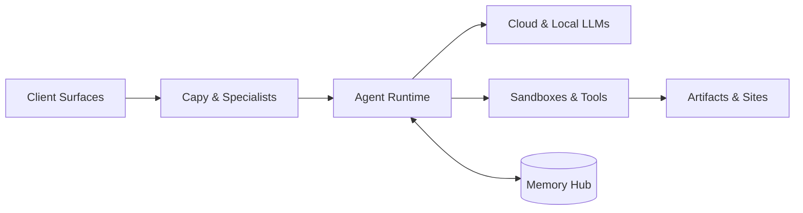

### Cold Start: Load the Save File, Then Get to Work

Instead of forcing every new agent to re-learn your project from scratch, Sandwalk turns the learning cost you have already paid into a **governed local save file** (`~/.sandwalk/`):

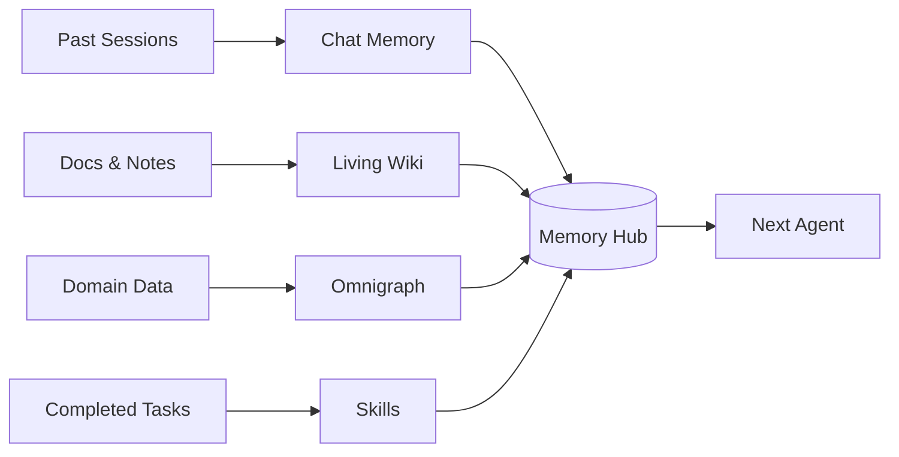

1. **Decoupled & Local-First (`~/.sandwalk/`)**: Swap models (17 cloud providers, ChatGPT Plus/Pro plan, or local `llama.cpp` / Ollama), sandboxes (Local machine or Modal cloud `T4`/`L4`/`A100`/`H100` GPUs), and MCP servers per turn while keeping all data on your machine in open files (`.md`, `.pg`, `.gq`, `.jsonl`, Lance `.omni`, SQLite).
2. **Capy Meta-Agent & Parallel Specialist Grids**: Don't settle for one point of view. **Capy** orchestrates the workspace—spawning parallel split grids (`2×2`, `3×2`), handing sessions to Claude Code or Codex, and coordinating customizable **Specialists** (starter personas **Otium**, **Atlas**, **Nova**, **Milo**, **Soren**, scientific profiles, or your own `+ New specialist`).
3. **Byte-Stable Prompt Prefix + Progressive Disclosure**: At session start, Sandwalk freezes a bounded snapshot (`USER.md` ~1,375 chars + `MEMORY.md` ~2,200 chars + `PRIORS.md` + Living Wiki TOC + Active Ontology) so LLM KV caches stay warm, while deep context is pulled on demand via tools.
4. **Six Runnable Omnigraph Cookbook Modes (`01–06`) & 1-Click Skill Crystallization**: Powered by the local [Omnigraph](https://www.omnigraph.dev/) Rust + Lance engine (`01 Industry intel`, `02 Pharma intel`, `03 Context graph`, `04 VC OS`, `05 Biomed research`, `06 Second brain`) with `Supports`/`Contradicts` provenance edges, Git-style `review/*` branches, and 1-click conversion of your Wiki + Ontology into reusable `~/.sandwalk/skills/<slug>/SKILL.md` skills. Full guide: [sandwalk.sh/docs/memory](https://sandwalk.sh/docs/memory).

## What Sandwalk does

| Pillar | What you get |
|--------|--------------|
| **One Workspace Everywhere** | Shared session list across the macOS/Ubuntu desktop app, Web UI, terminal CLI (`sandwalk`), LAN/phone, and external coding CLIs (**Claude Code**, **Codex**, **OpenCode**, **fx**, **Hermes**). |
| **Any Model, Cloud or Local** | 17 cloud providers (OpenAI, Anthropic, Gemini, xAI, DeepSeek, OpenRouter, Bedrock, etc.), **Sign in with ChatGPT** (Plus/Pro), local GGUF models via `llama.cpp`, Ollama, oMLX, and LM Studio, or **any OpenAI-compatible endpoint** (vLLM, SGLang, TGI, LiteLLM, custom HPC servers). |
| **Capy & Multi-Agent Grids** | Built-in meta-agent (**Capy**) that spawns parallel sessions, arranges split grids, seeds briefs across chats, manages memory/wiki/graph, and runs diagnostics or benchmarks by voice or text. |
| **Customizable Specialists** | Starter personas (**Otium**, **Atlas**, **Nova**, **Milo**, **Soren**) and scientific specialists—or create your own (`+ New specialist`) with custom priors (`PRIORS.md`), model, skills, MCPs, and brain. |
| **Memory, Wiki & Omnigraph** | Automatic post-run distillation into bounded `USER.md`/`MEMORY.md` snapshots, a full-screen Markdown Wiki with live preview & `[[wikilinks]]`, and a Lance-backed `.omni` Knowledge Graph with 6 Cookbook Modes (`01–06`). |
| **Skills & 1-Click MCPs** | Install public skills from [skills.sh](https://skills.sh), attach 1-click MCP servers, or crystallize your own project's Memory, Wiki, and Ontology into a reusable `/skill`. |
| **Local & Cloud GPU Sandboxes** | Execute code locally or on Modal CPU/GPU containers (`T4`, `L4`, `A10`, `A100`, `H100`). Every plot, 3D molecular structure, report, or `.ipynb` notebook lands beside the session, ready to publish to `sandwalk.site`. |
| **Scientific & Harness Evals** | 190+ built-in tools (PubChem, ChEMBL, UniProt, PDB, Open Targets, ClinicalTrials.gov, DepMap, MSigDB, STRING) plus end-to-end harness benchmarking (`sandwalk eval`) across MMLU-Pro, LiveCodeBench, BixBench, and Bio-Capybara. |

## Features

<table>
<tr>
<td width="50%" valign="top">
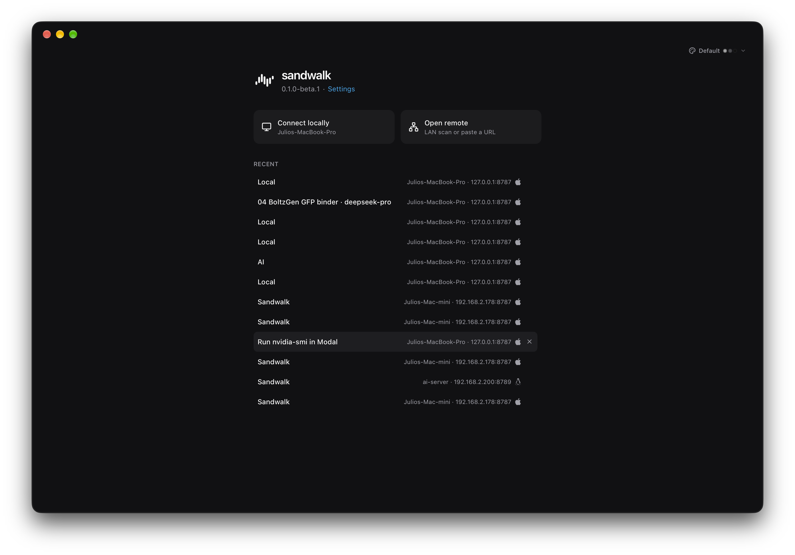<br>
<sub><strong>Sandwalk runs locally by default.</strong> Or it opens a remote server on your LAN or Tailnet.</sub>
</td>
<td width="50%" valign="top">
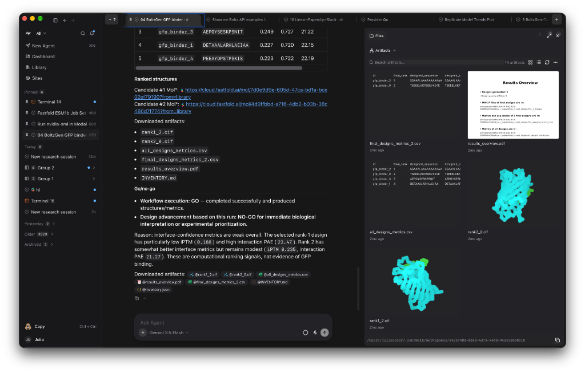<br>
<sub><strong>The composer is where a session starts.</strong> Model, Plan, Skills, Specialist, and Sandbox are right on the bar.</sub>
</td>
</tr>
<tr>
<td colspan="2" valign="top">
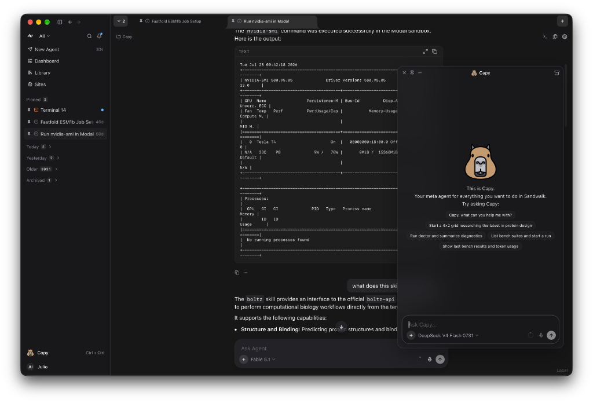<br>
<sub><strong>Capy orchestrates the workspace.</strong> Spawn parallel sessions, lay out a multi-agent grid, manage memories and skills, or launch evals from one meta-agent.</sub>
</td>
</tr>
<tr>
<td width="50%" valign="top">
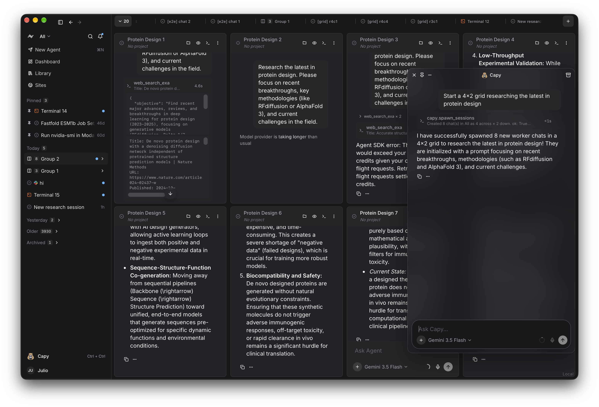<br>
<sub><strong>Several agents, one question.</strong> Same brief across different models or Specialists in a live split grid.</sub>
</td>
<td width="50%" valign="top">
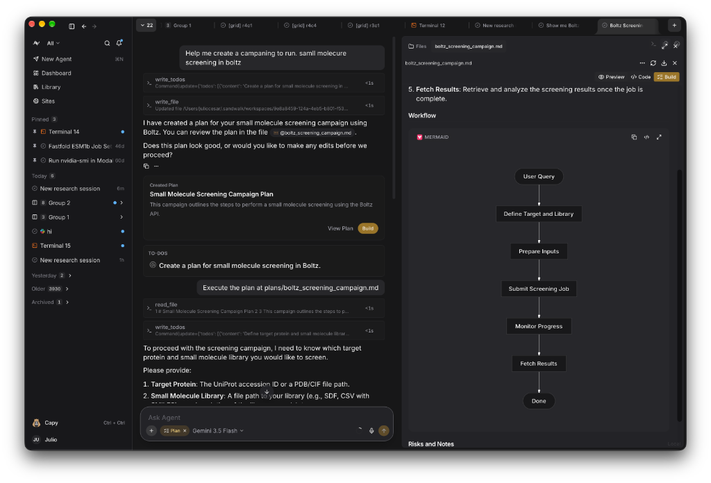<br>
<sub><strong>Start with a plan.</strong> Draft steps and a Mermaid flowchart first, then click Build to execute.</sub>
</td>
</tr>
<tr>
<td colspan="2" valign="top">
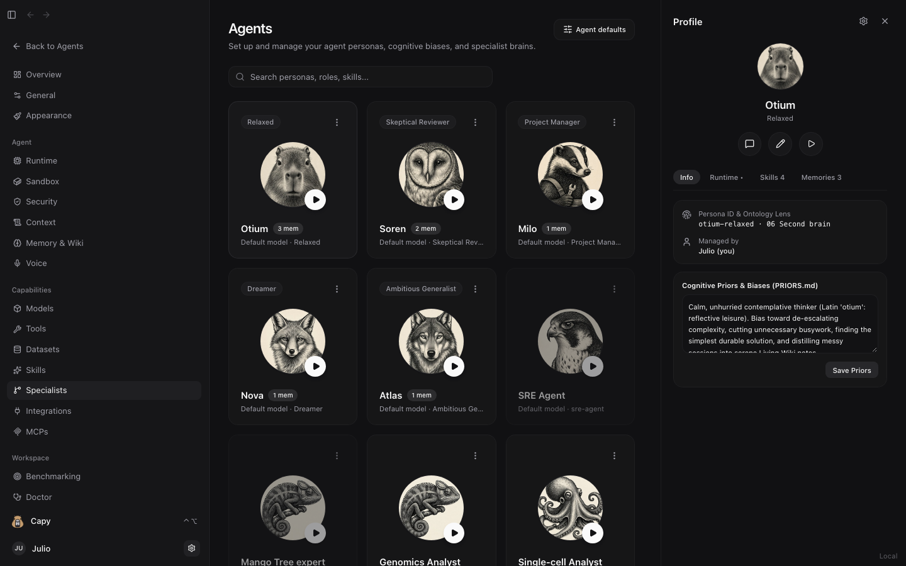<br>
<sub><strong>Specialists are customizable.</strong> Start from built-in personas (Otium, Soren, Milo, Nova, Atlas) and scientific profiles, or click <code>+ New specialist</code> to create your own with custom priors, model, skills, MCPs, and brain.</sub>
</td>
</tr>
<tr>
<td width="50%" valign="top">
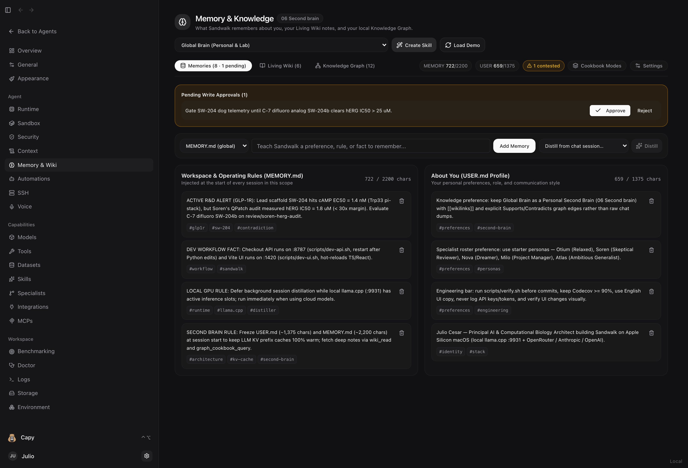<br>
<sub><strong>Bounded memory that never rots the prompt.</strong> Curated <code>MEMORY.md</code> rules, <code>USER.md</code> profile, and human-in-the-loop approvals.</sub>
</td>
<td width="50%" valign="top">
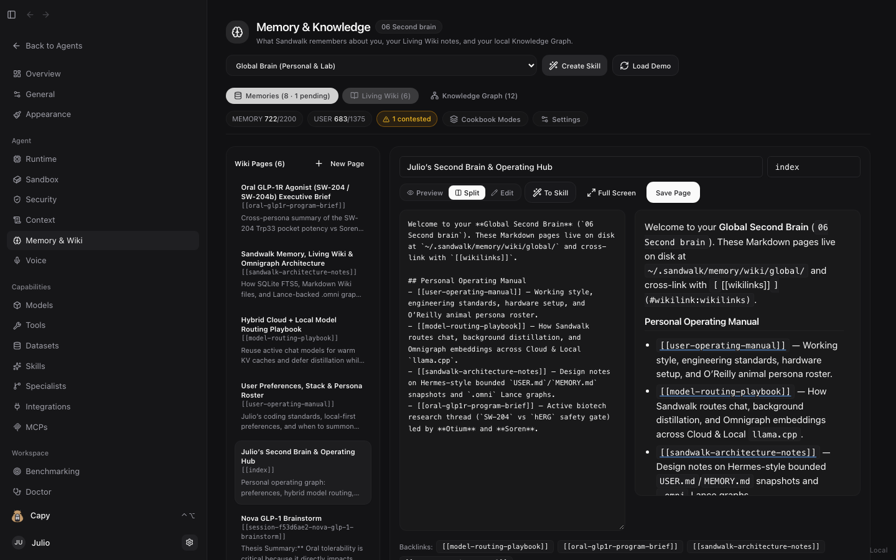<br>
<sub><strong>A Living Markdown Wiki on disk.</strong> Split-view editor, clickable <code>[[wikilinks]]</code>, full-screen mode, and one-click conversion to a Skill.</sub>
</td>
</tr>
<tr>
<td colspan="2" valign="top">
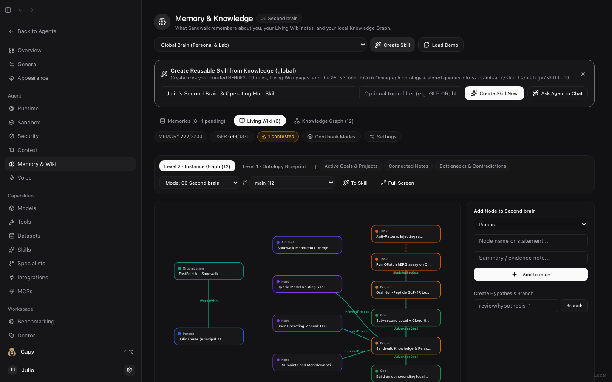<br>
<sub><strong>Versioned Knowledge Graph with Omnigraph.</strong> Six runnable Cookbook modes (01–06), supporting vs. contradicting claims, Git-style hypothesis branches, and one-click Skill crystallization.</sub>
</td>
</tr>
<tr>
<td width="50%" valign="top">
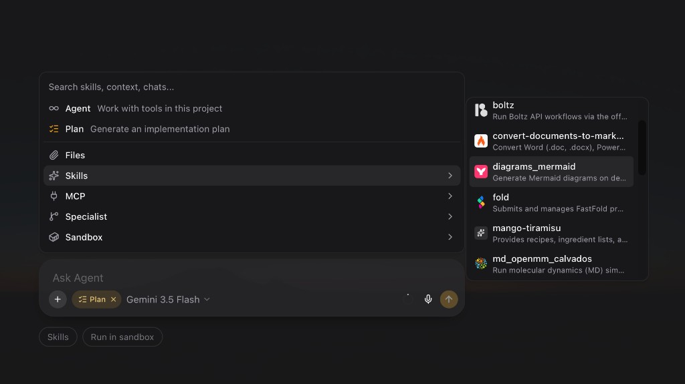<br>
<sub><strong>A skill rides with the message.</strong> Attach Files, Skills, MCP servers, a Specialist, or a Sandbox inline.</sub>
</td>
<td width="50%" valign="top">
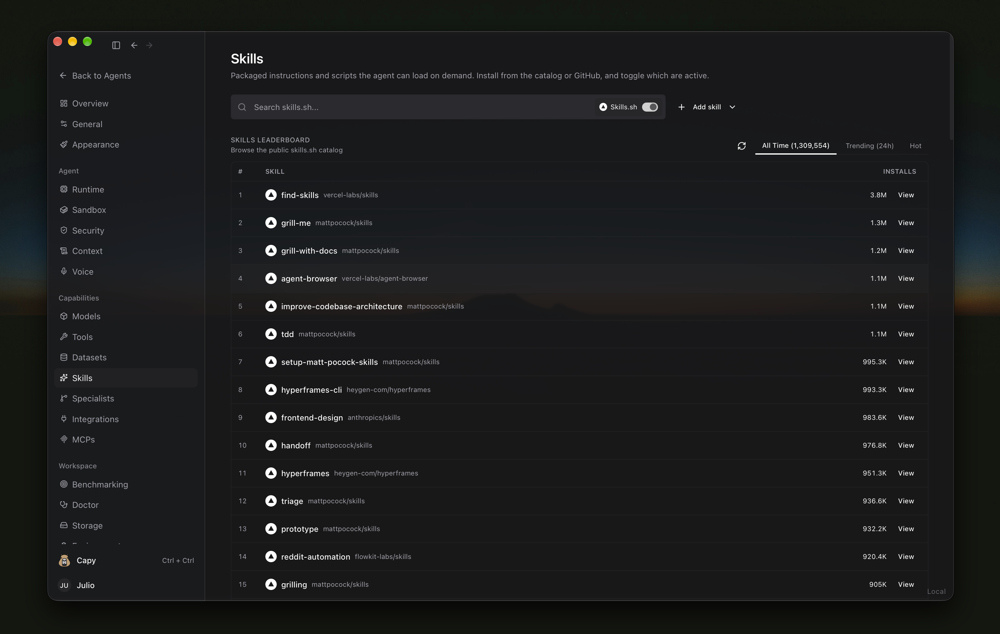<br>
<sub><strong>Install from skills.sh—or crystallize your own.</strong> Browse the public catalog ranked by installs, or turn your own Wiki and Ontology into a reusable <code>/skill</code>.</sub>
</td>
</tr>
<tr>
<td colspan="2" valign="top">
<br>
<sub><strong>A design round stays in the session.</strong> Ranked candidates, rendered 3D structures, and confidence metrics side by side.</sub>
</td>
</tr>
<tr>
<td width="50%" valign="top">
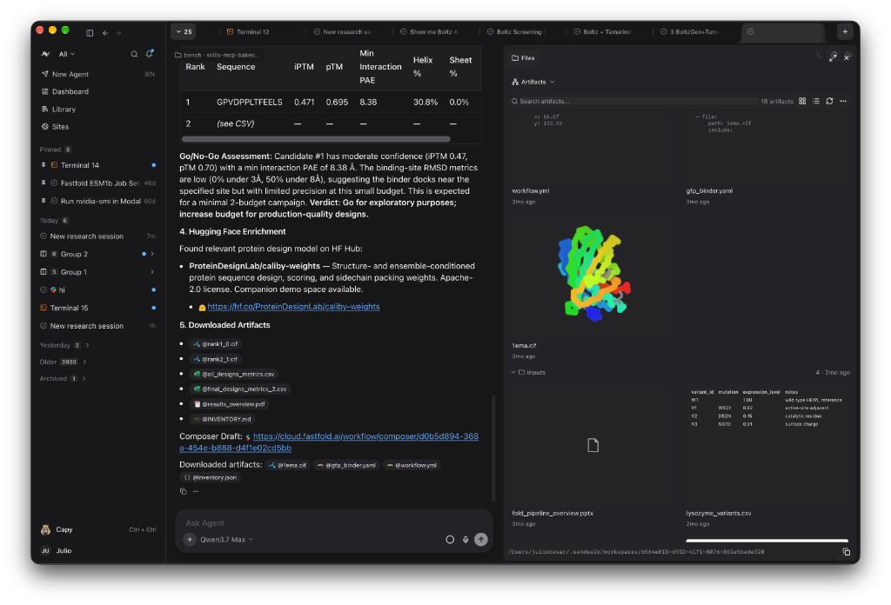<br>
<sub><strong>The agent brings the files back.</strong> Local or cloud GPU, every artifact lands in the session workspace.</sub>
</td>
<td width="50%" valign="top">
<br>
<sub><strong>A result can become a page.</strong> Preview locally, then publish to <code>sandwalk.site</code> after confirmation.</sub>
</td>
</tr>
<tr>
<td width="50%" valign="top">
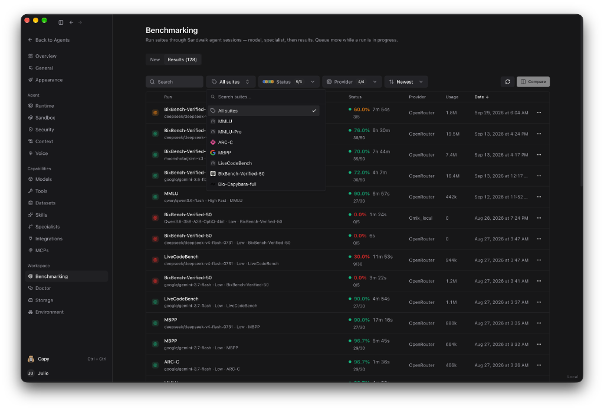<br>
<sub><strong>Evals score the whole harness.</strong> Measure model, Specialist, skills, tools, and sandbox together.</sub>
</td>
<td width="50%" valign="top">
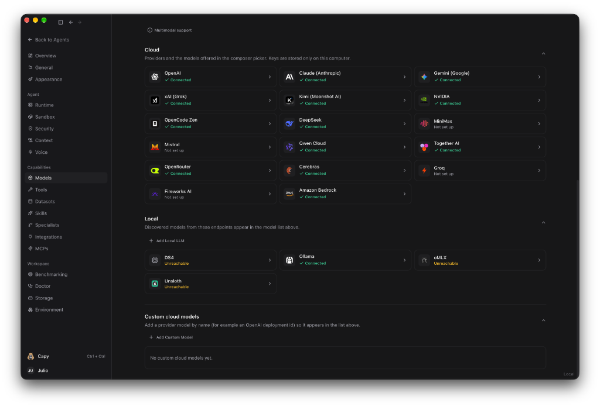<br>
<sub><strong>Keys stay on the machine.</strong> 17 cloud providers, ChatGPT plan sign-in, and local GGUF models.</sub>
</td>
</tr>
<tr>
<td colspan="2" valign="top">
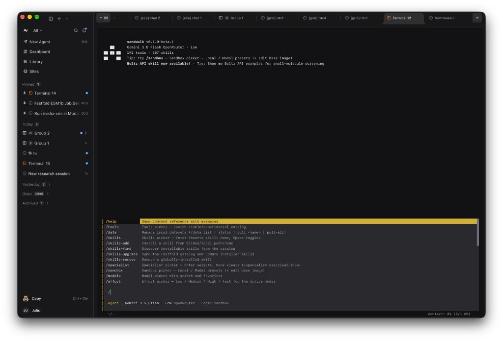<br>
<sub><strong>The same agent runs in the terminal.</strong> Shared sessions, shared memory, shared files.</sub>
</td>
</tr>
</table>

## Benchmarking & Evaluation

In science and ambitious engineering, changing a model, a Specialist, a skill, or a memory architecture should be **measured, not guessed**. Sandwalk includes a built-in evaluation harness (**Dashboard → Benchmarking** and `sandwalk eval` in the CLI) that runs real agent sessions end-to-end:

- **Shipped Benchmark Suites**: **MMLU**, **MMLU-Pro**, **ARC-C**, **MBPP**, **LiveCodeBench**, **BixBench** (bioinformatics & computational biology), and **Bio-Capybara**.
- **Full-Harness A/B Comparisons**: Queue multiple models or Specialists on the same suite, inspect per-question trajectories, token/cost breakdowns, and failed reasoning steps side by side.

### Benchmarking Roadmap (`TODO`)

We are actively expanding the evaluation harness to benchmark long-horizon memory, multi-agent collaboration, and skill crystallization:

- [ ] **Long-Horizon Memory & Omnigraph Recall Bench (`TODO`)** — Measure multi-session fact retention, `Supports` vs. `Contradicts` claim resolution, and KV-cache token efficiency across Cookbook modes `01–06`.
- [ ] **Skill Crystallization Lift Eval (`TODO`)** — Quantify accuracy and step-count improvements before vs. after crystallizing domain sessions into reusable `~/.sandwalk/skills/<slug>/SKILL.md` skills.
- [ ] **Multi-Specialist Grid vs. Single-Agent Ablations (`TODO`)** — Benchmark parallel Specialist cohorts (e.g., *Nova* + *Soren* + *Otium*) orchestrated by Capy against single-session baselines.
- [ ] **SWE-bench Verified & Terminal-Bench Suites (`TODO`)** — First-class software engineering and PTY terminal benchmark suites alongside `BixBench` and `Bio-Capybara`.
- [ ] **Automated CI Harness Regression Gates (`TODO`)** — Per-Specialist accuracy, latency, and token-budget gates enforced via `sandwalk eval` in CI.

## Models

Keys stay on this computer. Connected providers show up in the composer.

| Kind | Providers |
|------|-----------|
| Cloud | OpenAI, Claude (Anthropic), Gemini (Google), xAI, Kimi (Moonshot), NVIDIA, OpenCode Zen, DeepSeek, MiniMax, Mistral, Qwen Cloud, Together AI, OpenRouter, Cerebras, Groq, Fireworks AI, Amazon Bedrock |
| Local | Ollama, oMLX, Unsloth, DS4, llama.cpp, LM Studio, any OpenAI-compatible endpoint |

Local endpoints are discovered from `/v1/models` or Ollama's `/api/tags`. Add one with **Add Local LLM**, or in the CLI with `/model-manager`.

### Sign in with ChatGPT

OpenAI models can run on a ChatGPT Plus or Pro plan with no API key. In the app it is **Continue with ChatGPT** on the Model step or under Dashboard → Models; in a terminal:

```bash
sandwalk login chatgpt            # opens the browser, keeps tokens in ~/.sandwalk/chatgpt-auth.json
sandwalk login status
sandwalk logout chatgpt
```

Models then appear under **ChatGPT plan** in the picker. The same model under **OpenAI** still bills your API key; the row you pick decides.

## Other coding agents

Sandwalk reads and writes the session stores of **Claude Code**, **Codex**, **OpenCode**, **fx**, and **Hermes**—so you can run them inside a Sandwalk terminal with a live agent badge, import their transcripts as Sandwalk chats, or hand a Sandwalk chat to them:

- **Import**: Onboarding offers your recent sessions; later, right-click a terminal running one of these agents and choose **Convert to chat**, or ask Capy. The chat keeps the original folder as its workspace and is history-only until you send a message (or distill it into your Living Wiki and Omnigraph).
- **Continue in…**: On any chat, pick the agent. Sandwalk writes `.sandwalk/handoff-<id>.md` in the workspace and opens the CLI on it. For Claude Code and Codex, **native history** also synthesizes their native session file so `claude --resume` / `codex resume` open the conversation directly (with the handoff file always present as a fallback).
- **Capy**: *"import my last Codex session and distill its takeaways into the Wiki"*, *"open OpenCode in this project"*, *"hand this chat to Claude Code"*.

## CLI

Same sessions, same files. Type `sandwalk` in a terminal, or press **⌘⇧T** and type it in the app. `/` opens the command list.

### Commands

```bash
sandwalk setup                    # providers, keys, default model
sandwalk desktop                  # install the Mac app or Ubuntu .deb
sandwalk                          # interactive session
sandwalk "question"               # one-shot
sandwalk serve                    # local agent API on :8787
sandwalk serve --host 0.0.0.0     # expose to the LAN (needs sandwalk auth)
sandwalk auth                     # manage the API key for serve
sandwalk login chatgpt            # use a ChatGPT Plus/Pro plan for OpenAI models
sandwalk doctor                   # environment and configuration checks
sandwalk eval                     # run Bench suites headlessly
sandwalk skills add fastfold-ai/skills
sandwalk mcp list
sandwalk sandbox status           # Local Sandbox or Modal Sandbox
sandwalk data pull-all            # DepMap, MSigDB, STRING
sandwalk tool list
sandwalk upgrade
```

### Slash commands

| Command | What it does |
|---------|--------------|
| `/models`, `/effort` | Switch the model; set Low / Medium / High / Fast for models with thinking controls |
| `/plan` | Toggle Plan mode. Writes `plans/*.md` until you switch back to Agent |
| `/sandbox` | Pick Local or a Modal CPU/GPU preset; edit the base image inline |
| `/specialist` | Use, clear, or list specialists |
| `/skills`, `/skills-add`, `/skills-find` | Loaded skills; install from GitHub or a path; search the catalog |
| `/mcps` | Connect, enable, validate, add, or remove MCP servers |
| `/tools`, `/data` | Tool status; local datasets |
| `/usage`, `/compact` | Token and cost for the session; compress context |
| `/sessions`, `/resume`, `/new` | List, resume, or start sessions |
| `/export`, `/notebook` | Transcript to markdown; session to `.ipynb` |
| `/agents` | Run a question across N parallel agents |
| `/doctor` | Readiness diagnostics with fix hints |

`Enter` submits, `Ctrl+J` inserts a newline, paste an image to attach it, `Ctrl+C` interrupts. Full reference: [`cli/README.md`](cli/README.md).

## Configuration

Everything lives under `~/.sandwalk/`:

| Path | Contents |
|------|----------|
| `config.json` | Providers, keys, default model, sandbox & memory preferences |
| `mcp.json` | MCP servers, Cursor-compatible (including `omnigraph` stdio MCP) |
| `skills/` | Installed & crystallized skills (`<slug>/SKILL.md` + `references/`) |
| `memory/` | `USER.md`, `MEMORY.md`, `memory.db`, `wiki/<scope>/*.md`, and `omni/<scope>/graph.omni` |
| `bin/` | Managed local binaries (`omnigraph`, `omnigraph-server`, `sandwalk-omnigraph-mcp`) |
| `workspaces/<session>/` | Per-session artifacts: `uploads/`, `outputs/`, `plans/`, `project/` |
| `data/` | Local datasets from `sandwalk data pull` |
| `agent-server.db` | Sessions, shared by the CLI and the app |

The Mac app stores its own window and server settings in `~/Library/Application Support/Sandwalk/`. `sandwalk config show` prints the active configuration; `sandwalk config set <key> <value>` changes one key.

Provider keys can also come from the environment (`OPENAI_API_KEY`, `ANTHROPIC_API_KEY`, `OPENROUTER_API_KEY`, `MOONSHOT_API_KEY`, and so on). Modal needs `MODAL_TOKEN_ID` and `MODAL_TOKEN_SECRET`, or run `modal setup`.

## Development

Monorepo:

| Directory | Contents |
|-----------|----------|
| `cli/` | Python agent, tools, skills, and the FastAPI server |
| `apps/local-web/` | React dashboard and the Tauri shell |
| `apps/sandwalk-mac/` | Swift menubar helper that supervises the server |
| `apps/packaging/` | Signed DMG, notarization, updater artifacts |

```bash
scripts/verify.sh         # typecheck, lint, build, unit tests + coverage gates (web + cli) — the CI gate
scripts/verify.sh e2e     # Playwright: grid, terminals, PTY round-trip
pnpm e2e:bench            # perf report → apps/local-web/e2e/results/grid-latest.json
./apps/packaging/package-macos-dmg.sh    # signed DMG; INSTALL=1 copies it to ~/Applications
```

Working with an AI agent? [AGENTS.md](AGENTS.md) and the project skills in `.cursor/skills/` encode the dev and test loop. See [CONTRIBUTING.md](CONTRIBUTING.md), [.github/TESTING.md](.github/TESTING.md), and [apps/packaging/APPLE-SIGNING.md](apps/packaging/APPLE-SIGNING.md).

## References & Acknowledgments

Sandwalk builds on and draws direct inspiration from several open-source projects and research harnesses:

- **[Omnigraph (`ModernRelay/omnigraph`)](https://github.com/ModernRelay/omnigraph)** & **[omnigraph.dev](https://www.omnigraph.dev/)** — Versioned Rust + Lance graph engine, declarative `.pg` schemas, `.gq` stored queries, Git-style branching, and runnable Cookbook ontologies.
- **[LangChain](https://github.com/langchain-ai/langchain)**, **[LangGraph](https://github.com/langchain-ai/langgraph)** & **[Deep Agents (`langchain-ai/deepagents`)](https://github.com/langchain-ai/deepagents)** — Core agent execution graph, streaming tool orchestration, and multi-provider model adapters.
- **[Hermes Agent (`NousResearch/hermes-agent`)](https://github.com/NousResearch/hermes-agent)** — Bounded session-start `USER.md` / `MEMORY.md` snapshot architecture (preserving KV prefix caches) and SQLite FTS5 `session_search`.
- **[TencentDB Agent Memory (`TencentCloud/TencentDB-Agent-Memory`)](https://github.com/TencentCloud/TencentDB-Agent-Memory)** — Four-asset memory hub (`Chat Memory`, `Skill`, `Wiki`, `Graph`) and the "Cold Start: Load the Save File" skill crystallization model.
- **[skills.sh (`vercel-labs/skills`)](https://skills.sh)** — Open `SKILL.md` package specification and public agent skills catalog.
- **[llama.cpp (`ggml-org/llama.cpp`)](https://github.com/ggml-org/llama.cpp)** & **[Modal](https://modal.com)** — Local GGUF model/embedding inference and on-demand cloud CPU/GPU sandboxes.

## License

[Apache License 2.0](LICENSE). Copyright © 2026 Fastfold AI Labs.
