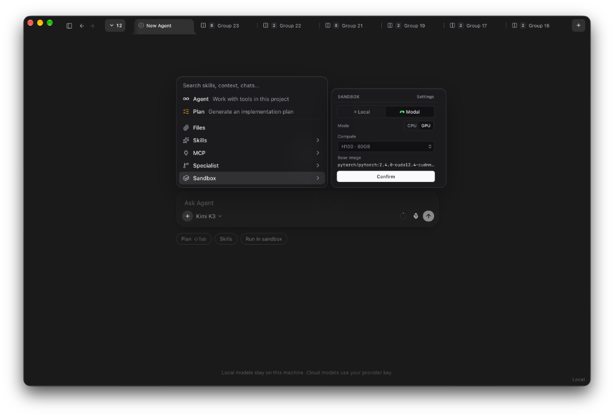
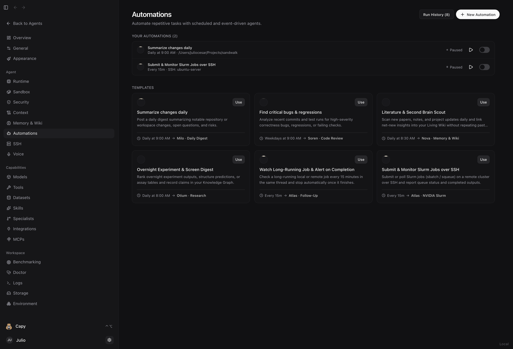
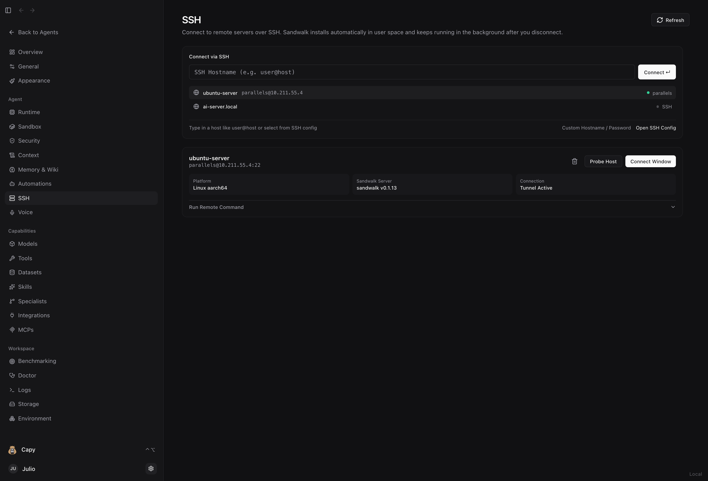

<p align="center">
  <a href="https://github.com/fastfold-ai/sandwalk"><picture>
    <source media="(prefers-color-scheme: dark)" srcset="images/sandwalk-logo-dark.svg">
    <source media="(prefers-color-scheme: light)" srcset="images/sandwalk-logo-light.svg">
    
  </picture></a>
</p>

<p align="center">
  <strong>An agent workspace for long-running work, on hardware you control.</strong>
</p>

<p align="center">
  <a href="#the-short-version">Overview</a> ·
  <a href="#why-people-use-it">Why Sandwalk</a> ·
  <a href="#tour">Tour</a> ·
  <a href="#install">Install</a> ·
  <a href="#cli">CLI</a> ·
  <a href="#memory-without-prompt-rot">Memory</a> ·
  <a href="https://sandwalk.sh/docs">Docs</a> ·
  <a href="https://sandwalk.sh">sandwalk.sh</a>
</p>

<p align="center">
  <a href="https://github.com/fastfold-ai/sandwalk/actions/workflows/ci.yml"></a>
  <a href="https://app.codecov.io/gh/fastfold-ai/sandwalk"></a>
  <a href="LICENSE"></a>
</p>

<p align="center">
  
</p>

---

## The short version

Darwin had a gravel path behind Down House that he called the Sandwalk. When he had a hard problem, he walked loops around it until the pieces fit together.

This project is built for that kind of work: problems that take days or weeks of iteration, not a single clever prompt.

Most AI tools are stateless chat boxes tied to one model vendor. Every new thread starts with amnesia, so you spend the first ten minutes pasting context and re-explaining your repo, your server, or your dataset.

Sandwalk flips the setup. A local server runs on your machine (or on a remote Linux box over SSH) and keeps your sessions, files, wiki pages, knowledge graph, and skills on disk under `~/.sandwalk/`. The native macOS/Ubuntu desktop app, the web UI, and the `sandwalk` terminal CLI are all clients of that same server.

You bring your own keys, your existing ChatGPT Plus/Pro login, or local GGUF weights. Nothing is locked inside a proprietary cloud.

---

## Why people use it

- **Run a split grid instead of trusting one model.** Ask **Capy** (the built-in meta-agent) to fan a prompt across a `2×2` or `3×2` grid of different models or Specialists. Compare their reasoning and outputs live in one window.
- **Point it at any SSH box and it sets itself up.** Enter `user@host` in **SSH** and click **Connect**. Sandwalk logs in, installs the CLI in `~/.local/bin` without `sudo`, starts a background daemon that stays alive after you disconnect, and opens a window tunneled to that machine.
- **Put repetitive checks on a timer.** Create an Automation (`every 15m`, `daily at 9am`, cron, or a webhook) that runs a command locally or over SSH and only wakes the model when the output changes.
- **Keep your existing terminal agents.** Run **Claude Code**, **Codex**, **OpenCode**, **fx**, or **Hermes** inside Sandwalk terminals with live status badges. Convert any of their transcripts into a Sandwalk chat, or hand a Sandwalk chat straight into `claude --resume` or `codex resume`.
- **Turn finished work into a reusable skill.** Distill sessions into your **Living Wiki** and **Omnigraph** knowledge graph, then click **Create Skill** to package the method into `~/.sandwalk/skills/<slug>/SKILL.md` for the next run.
- **Burst to cloud GPUs when your laptop is not enough.** Run code locally by default, or attach a Modal container (`T4`, `L4`, `A10`, `A100`, `H100`) per session. Every plot, 3D structure, or notebook lands back in your local workspace folder.

---

## Tour

<table>
<tr>
<td colspan="2" valign="top">
<br>
<sub><strong>The composer holds the controls.</strong> Model, Plan, Skills, Specialist, and Sandbox sit right on the input bar.</sub>
</td>
</tr>
<tr>
<td width="50%" valign="top">
<br>
<sub><strong>Local first, remote when you need it.</strong> Connect to this Mac or open a remote server over LAN, Tailscale, or SSH.</sub>
</td>
<td width="50%" valign="top">
<br>
<sub><strong>Local compute or cloud GPUs on demand.</strong> Run on your machine or switch to a Modal GPU container (<code>T4</code> up to <code>H100 · 80GB</code>) with a custom base image right from the composer.</sub>
</td>
</tr>
<tr>
<td colspan="2" valign="top">
<br>
<sub><strong>Capy coordinates the workspace.</strong> Spawn parallel sessions, arrange a split grid, manage memory and skills, or launch evals by voice or text.</sub>
</td>
</tr>
<tr>
<td width="50%" valign="top">
<br>
<sub><strong>Several agents, one question.</strong> Same brief across different models or Specialists in a live split grid.</sub>
</td>
<td width="50%" valign="top">
<br>
<sub><strong>Plan before building.</strong> Draft steps and a Mermaid diagram first, then click Build to run it.</sub>
</td>
</tr>
<tr>
<td colspan="2" valign="top">
<br>
<sub><strong>Custom Specialists.</strong> Start from built-in personas (Otium, Soren, Milo, Nova, Atlas) and scientific profiles, or create your own with custom priors, model, skills, and MCPs.</sub>
</td>
</tr>
<tr>
<td width="50%" valign="top">
<br>
<sub><strong>Curated memory with human review.</strong> Bounded <code>MEMORY.md</code> operating rules, <code>USER.md</code> profile, and an approval queue.</sub>
</td>
<td width="50%" valign="top">
<br>
<sub><strong>Living Markdown Wiki.</strong> Split-view editor on disk, clickable <code>[[wikilinks]]</code>, full-screen preview, and one-click export to a Skill.</sub>
</td>
</tr>
<tr>
<td colspan="2" valign="top">
<br>
<sub><strong>Omnigraph knowledge graph.</strong> Six runnable Cookbook modes (01 to 06), supporting vs. contradicting evidence, Git-style branches, and one-click Skill creation.</sub>
</td>
</tr>
<tr>
<td width="50%" valign="top">
<br>
<sub><strong>Scheduled Automations.</strong> Run recurring or one-shot jobs (<code>every 15m</code>, <code>daily at 9am</code>, cron, or webhooks) in a fresh chat or an existing thread.</sub>
</td>
<td width="50%" valign="top">
<br>
<sub><strong>Remote-SSH manager.</strong> Connect to any Linux or macOS server over SSH. Sandwalk installs in user space and keeps running after you close your laptop.</sub>
</td>
</tr>
<tr>
<td width="50%" valign="top">
<br>
<sub><strong>Inline attachments.</strong> Attach Files, Skills, MCP servers, a Specialist, or a Sandbox directly to a turn.</sub>
</td>
<td width="50%" valign="top">
<br>
<sub><strong>Open skills catalog.</strong> Install community skills from <code>skills.sh</code> or package your own Wiki and graph into a local <code>/skill</code>.</sub>
</td>
</tr>
<tr>
<td colspan="2" valign="top">
<br>
<sub><strong>Scientific & molecular workflows.</strong> Ranked candidates, 3D molecular structures, and confidence metrics inside the chat.</sub>
</td>
</tr>
<tr>
<td width="50%" valign="top">
<br>
<sub><strong>Every output lands on disk.</strong> Local or cloud GPU, generated files come back to the session workspace.</sub>
</td>
<td width="50%" valign="top">
<br>
<sub><strong>Publish when ready.</strong> Preview interactive pages locally, then publish to <code>sandwalk.site</code>.</sub>
</td>
</tr>
<tr>
<td width="50%" valign="top">
<br>
<sub><strong>Harness benchmarks.</strong> Score model, Specialist, skills, tools, and sandbox together across standard suites.</sub>
</td>
<td width="50%" valign="top">
<br>
<sub><strong>Bring any model.</strong> 17 cloud providers, ChatGPT plan sign-in, and local GGUF weights.</sub>
</td>
</tr>
<tr>
<td colspan="2" valign="top">
<br>
<sub><strong>Full terminal TUI.</strong> The same sessions, memory, and files from your shell.</sub>
</td>
</tr>
</table>

---

## Memory without prompt rot

Stuffing old transcripts into a vector database or a giant system prompt degrades reasoning and invalidates your LLM prompt cache on every turn.

Sandwalk freezes a compact prefix at the start of a session (`USER.md`, `MEMORY.md`, `PRIORS.md`, the Wiki table of contents, and the active graph schema) so KV caches stay warm. Deeper context lives on disk under `~/.sandwalk/` and is read on demand when the agent needs it:


Full walkthrough: [sandwalk.sh/docs/memory](https://sandwalk.sh/docs/memory).

---

## Install

### Desktop app

Download an installer from the [latest release](https://github.com/fastfold-ai/sandwalk/releases/latest):

| Platform | Package |
|---|---|
| macOS (Apple Silicon, 12.0+) | [Sandwalk-macos-arm64.dmg](https://github.com/fastfold-ai/sandwalk/releases/latest/download/Sandwalk-macos-arm64.dmg) |
| Ubuntu (amd64) | [Sandwalk_0.1.14_amd64.deb](https://github.com/fastfold-ai/sandwalk/releases/latest/download/Sandwalk_0.1.14_amd64.deb) |
| Ubuntu (arm64) | [Sandwalk_0.1.14_arm64.deb](https://github.com/fastfold-ai/sandwalk/releases/latest/download/Sandwalk_0.1.14_arm64.deb) |

On Ubuntu 24.04 or 26.04, you can also install and update through APT:

```bash
curl -fsSL https://apt.sandwalk.sh/sandwalk.gpg | sudo gpg --dearmor -o /usr/share/keyrings/sandwalk.gpg
echo "deb [arch=amd64,arm64 signed-by=/usr/share/keyrings/sandwalk.gpg] https://apt.sandwalk.sh stable main" | sudo tee /etc/apt/sources.list.d/sandwalk.list
sudo apt update && sudo apt install sandwalk
```

### CLI (macOS & Linux)

```bash
curl -fsSL https://sandwalk.sh/install.sh | bash
sandwalk setup      # providers, API keys, or ChatGPT Plus/Pro login
sandwalk desktop    # optional: installs the desktop app for your OS
```

### From source

```bash
git clone https://github.com/fastfold-ai/sandwalk.git
cd sandwalk
pnpm install
cd cli && uv sync --extra all && cd ..
scripts/dev-api.sh        # agent API on :8787
scripts/dev-ui.sh         # Tauri window + Vite on :1420 (`web` for browser only)
```

---

## CLI

Run `sandwalk` in any terminal, or press **⌘⇧T** in the desktop app.

```bash
sandwalk                          # interactive TUI session
sandwalk "question"               # one-shot prompt
sandwalk setup                    # configure providers, keys, and default model
sandwalk login chatgpt            # use a ChatGPT Plus/Pro plan for OpenAI models
sandwalk serve                    # run the local agent API on :8787
sandwalk cron list                # list and trigger scheduled Automations
sandwalk ssh list                 # manage SSH hosts, remote commands, and tunnels
sandwalk skills add fastfold-ai/skills
sandwalk mcp list
sandwalk sandbox status           # Local or Modal GPU sandbox
sandwalk eval                     # run benchmark suites (MMLU-Pro, LiveCodeBench, BixBench)
sandwalk doctor                   # check environment and provider health
sandwalk upgrade
```

Inside an interactive session, `/` opens the command menu (`/models`, `/effort`, `/plan`, `/specialist`, `/skills`, `/mcps`, `/sandbox`, `/agents`, `/compact`, `/export`). Full CLI reference: [`cli/README.md`](cli/README.md).

---

## Benchmarks & Roadmap

Sandwalk includes an evaluation runner (**Dashboard → Benchmarking** and `sandwalk eval`) that tests the full harness (model, Specialist, skills, tools, and sandbox) end to end:

| Shipped suites | Next up on the roadmap |
|---|---|
| **MMLU**, **MMLU-Pro**, **ARC-C**, **MBPP**, **LiveCodeBench** | **Long-horizon memory & Omnigraph recall bench** across Cookbook modes `01–06` |
| **BixBench** (bioinformatics) & **Bio-Capybara** | **Skill crystallization lift evals** (before vs. after packaging a `/skill`) |
| Multi-model and multi-Specialist A/B runs with per-step trajectories | **Multi-Specialist grid vs. single-agent ablations** |
| Token, latency, and cost breakdowns per question | **SWE-bench Verified** & **Terminal-Bench** PTY suites |

---

## Disk layout (`~/.sandwalk/`)

| Path | Contents |
|------|----------|
| `config.json` | Providers, API keys, active model, sandbox and memory settings |
| `mcp.json` | MCP servers (Cursor-compatible, including the local `omnigraph` server) |
| `skills/` | Installed and user-created skills (`<slug>/SKILL.md` + `references/`) |
| `memory/` | `USER.md`, `MEMORY.md`, `memory.db`, `wiki/<scope>/*.md`, and `omni/<scope>/graph.omni` |
| `bin/` | Managed local binaries (`omnigraph`, `omnigraph-server`, `sandwalk-omnigraph-mcp`) |
| `workspaces/<session>/` | Per-session files: `uploads/`, `outputs/`, `plans/`, `project/` |
| `agent-server.db` | Sessions, Automations, and SSH hosts shared by the CLI and desktop app |

---

## Development

| Directory | Contents |
|-----------|----------|
| `cli/` | Python agent, 190+ tools, built-in skills, Automations & SSH services, FastAPI server |
| `apps/local-web/` | React dashboard and Tauri desktop shell |
| `apps/sandwalk-mac/` | Swift menubar helper that supervises the local server |
| `apps/packaging/` | Signed macOS DMG, notarization, Ubuntu `.deb` & APT scripts |

```bash
scripts/verify.sh         # typecheck, lint, build, unit tests + coverage gates (web + cli)
scripts/verify.sh e2e     # Playwright: grid, terminals, PTY round-trip
pnpm e2e:bench            # perf report -> apps/local-web/e2e/results/grid-latest.json
```

See [AGENTS.md](AGENTS.md), [CONTRIBUTING.md](CONTRIBUTING.md), [.github/TESTING.md](.github/TESTING.md), and [apps/packaging/APPLE-SIGNING.md](apps/packaging/APPLE-SIGNING.md).

## Acknowledgments

Sandwalk builds on and draws inspiration from:
- **[Omnigraph (`ModernRelay/omnigraph`)](https://github.com/ModernRelay/omnigraph)** & **[omnigraph.dev](https://www.omnigraph.dev/)**: Versioned Rust + Lance graph engine, `.pg` schemas, `.gq` queries, Git-style branching, and Cookbook ontologies.
- **[LangChain](https://github.com/langchain-ai/langchain)**, **[LangGraph](https://github.com/langchain-ai/langgraph)** & **[Deep Agents (`langchain-ai/deepagents`)](https://github.com/langchain-ai/deepagents)**: Core agent execution graph, streaming tool orchestration, and model adapters.
- **[Hermes Agent (`NousResearch/hermes-agent`)](https://github.com/NousResearch/hermes-agent)**: Bounded session-start `USER.md` / `MEMORY.md` snapshot design and SQLite FTS5 `session_search`.
- **[TencentDB Agent Memory (`TencentCloud/TencentDB-Agent-Memory`)](https://github.com/TencentCloud/TencentDB-Agent-Memory)**: Four-asset memory hub (`Chat Memory`, `Skill`, `Wiki`, `Graph`) and the save-file skill model.
- **[skills.sh (`vercel-labs/skills`)](https://skills.sh)**: Open `SKILL.md` specification and public skills catalog.
- **[llama.cpp (`ggml-org/llama.cpp`)](https://github.com/ggml-org/llama.cpp)** & **[Modal](https://modal.com)**: Local GGUF inference and on-demand cloud CPU/GPU sandboxes.

## License

[Apache License 2.0](LICENSE). Copyright © 2026 Fastfold AI Labs.
