<h1 align="center" style="margin:0;">
  <a href="https://github.com/fastfold-ai/sandwalk"><picture>
    <source media="(prefers-color-scheme: dark)" srcset="images/sandwalk-logo-dark.svg">
    <source media="(prefers-color-scheme: light)" srcset="images/sandwalk-logo-light.svg">
    
  </picture></a>
</h1>
<h3 align="center" style="margin: 0; margin-top: 0.5rem;">
A thinking path for open science.
</h3>

<p align="center">
  <a href="https://github.com/fastfold-ai/sandwalk/actions/workflows/ci.yml"></a>
  <a href="https://codecov.io/gh/fastfold-ai/sandwalk"></a>
</p>

<p align="center">
  <a href="#features">Features</a> •
  <a href="#install">Install</a> •
  <a href="#quickstart">Quickstart</a> •
  <a href="#web-dashboard">Web Dashboard</a> •
  <a href="#usage">Usage</a> •
  <a href="#documentation">Documentation</a> •
  <a href="#contributing--from-source">Contributing</a>
</p>
<br>
<p align="center">
  <picture>
    <source media="(prefers-color-scheme: dark)" srcset="images/showcase-dark.png">
    <source media="(prefers-color-scheme: light)" srcset="images/showcase-light.png">
    
  </picture>
</p>
<br>

**sandwalk** is a self-hosted science agent for researchers. Ask a question, attach files, install skills, and let the agent walk the research path with you: multi-step workflows, sandboxes, and results in one place. Built for biology and drug discovery, and happy to stretch beyond them.

Use the CLI or the web dashboard: same sessions, workspace, and history. A macOS app can keep the local stack warm. Run on your machine by default; send heavy jobs to cloud GPUs when you need them.

## Features

- **CLI ↔ web**: one agent session, two surfaces (terminal and dashboard).
- **Plan mode**: draft `plans/*.md` with todos and a Mermaid flowchart, then **Build** when ready.
- **Multimodal**: `@`-attach images, PDFs, audio, and video (Gemini takes the full set).
- **Tools you can grow**: install as many as you want; we curate a starter set for chemistry, targets, structures, omics, clinical, literature, and more.
- **Live databases**: PubChem, ChEMBL, UniProt, PDB, Open Targets, ClinicalTrials.gov, GTEx, STRING, Ensembl, NCBI, …
- **Local datasets**: optional DepMap, PRISM, L1000, proteomics, MSigDB, STRING (`sandwalk data pull-all`).
- **Local + cloud compute**: Local Sandbox on your machine, or Modal / Lambda / Fastfold Cloud for GPU jobs.
- **Skills & MCPs**: install from GitHub or [skills.sh](https://skills.sh); connect remote MCPs via Cursor-compatible `~/.sandwalk/mcp.json`.
- **Specialists**: reusable skill + MCP + instruction packs for focused research modes.
- **Viewers**: structures, plots, and artifacts beside the chat.

### Tools, data, and models

We ship a curated toolkit out of the box (targets and genetics, chemistry, protein structure and design, expression / single-cell, clinical and translational, literature, safety / PK / stats), and you can keep installing more. Browse what you have with `sandwalk tool list` and `sandwalk data list`.

**Models** (via `sandwalk setup`, the dashboard, or `sandwalk config`): Anthropic, OpenAI, Google Gemini, xAI (Grok), NVIDIA, OpenCode Zen, plus local OpenAI-compatible endpoints like Ollama, Unsloth, oMLX, DS4, llama.cpp, and LM Studio.

**Integrations** (`sandwalk keys` / Dashboard → Integrations): Modal, LangSmith, Tavily, Slack, Vercel, NVIDIA, OpenCode Zen, custom webhooks.

**MCP catalog** (seeded in Dashboard → MCPs): Tamarind Bio, Paperclip, Latch Bio, Neurosnap, plus Linear, Lucid, and any custom URL.

## Install

### CLI (recommended)

Requires [uv](https://docs.astral.sh/uv/) and Python 3.11+.

```bash
uv tool install sandwalk
sandwalk --version
```

Core deps (agent server, Local Sandbox plotting, Modal client, …) come with the default install. Optional science stacks are extras:

```bash
uv tool install "sandwalk[all]"          # chemistry, single-cell, ML, …
# or: uv tool install "sandwalk[chemistry]"
```

```bash
sandwalk upgrade
```

### macOS app

```bash
cd apps/sandwalk-mac
./scripts/package-app.sh
open ~/Applications/Sandwalk.app
```

Or grab a build from [GitHub Releases](https://github.com/fastfold-ai/sandwalk/releases) when published.

## Quickstart

### macOS App

Launch **Sandwalk.app**. The menu bar starts / stops the agent server, opens the dashboard, and exposes Settings for ports, models, tools, and skills.

<p align="center">
  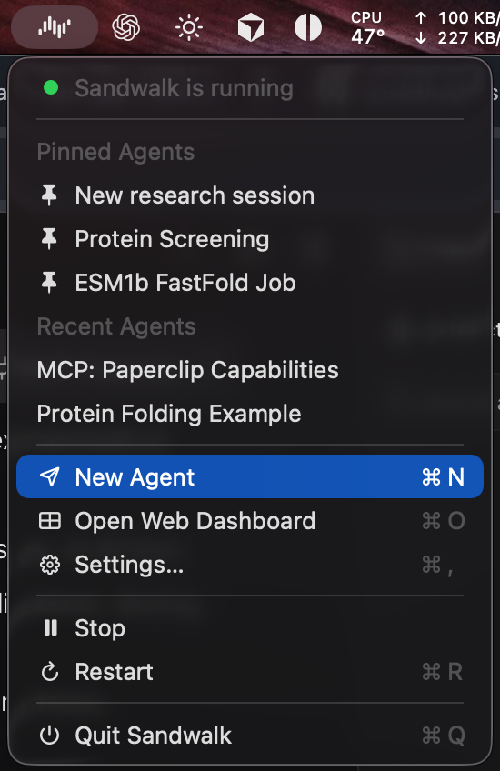
  &nbsp;&nbsp;
  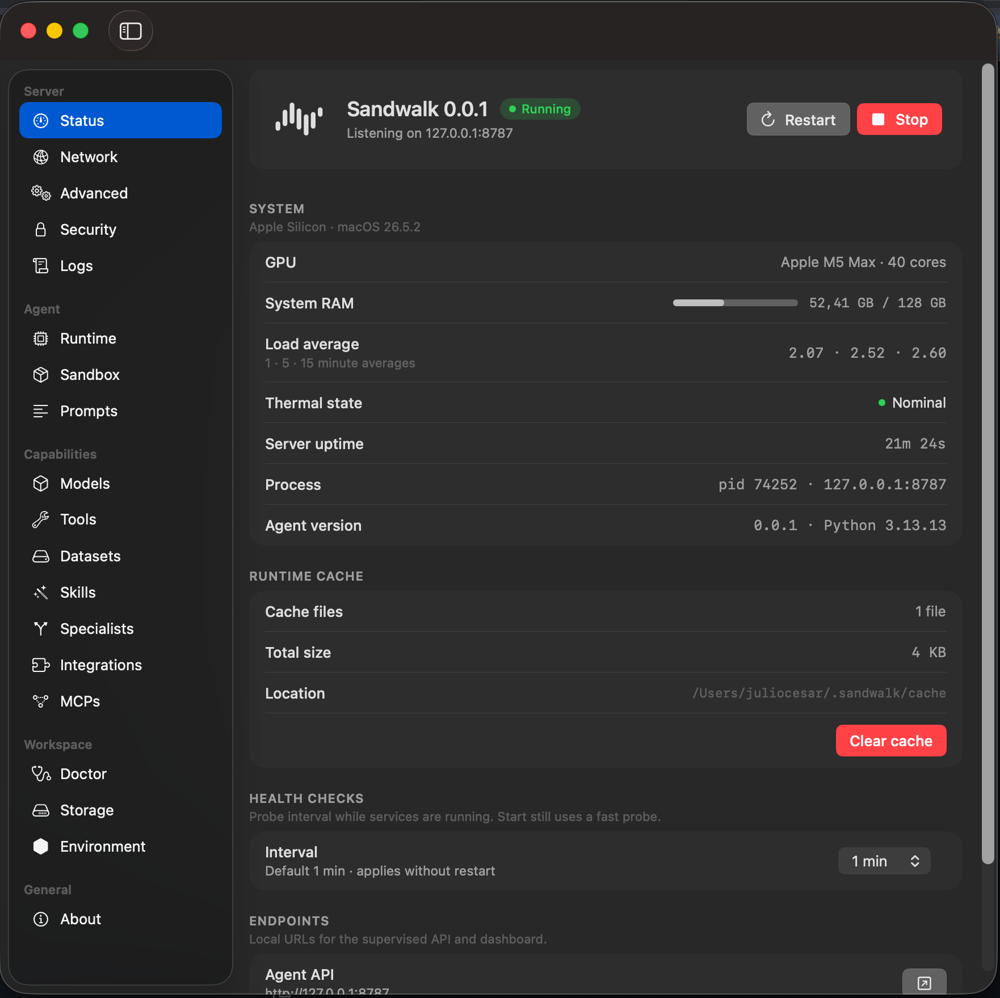
</p>

### CLI

```bash
sandwalk setup          # models, keys, skills
sandwalk doctor

sandwalk                # interactive (shares sessions with the dashboard)
sandwalk "What is known about KRAS G12C inhibitors?"

sandwalk serve          # API + dashboard (or use Sandwalk.app)
```

| Service   | Default URL             |
|-----------|-------------------------|
| Agent API | http://127.0.0.1:8787   |
| Dashboard | http://127.0.0.1:8969   |

```bash
sandwalk auth generate && sandwalk auth enable   # optional API key
sandwalk skills add fastfold-ai/skills
sandwalk data pull-all                           # optional local corpora
```

## Web Dashboard

Open `http://127.0.0.1:8969` after `sandwalk serve` (or **Open Web Dashboard** from the Mac app). Chat, files, viewers, and a terminal share the same sessions as the CLI.

<p align="center">
  <picture>
    <source media="(prefers-color-scheme: dark)" srcset="images/showcase-web-dark.png">
    <source media="(prefers-color-scheme: light)" srcset="images/showcase-web-light.png">
    
  </picture>
</p>

### Overview and projects

Overview shows a year-long session heatmap plus featured skills, MCPs, and integrations. **Projects** scope sessions and files to a campaign; each project can set **Agent Context** that every agent in that project inherits.

<p align="center">
  <picture>
    <source media="(prefers-color-scheme: dark)" srcset="images/showcase-projects-dark.png">
    <source media="(prefers-color-scheme: light)" srcset="images/showcase-projects-light.png">
    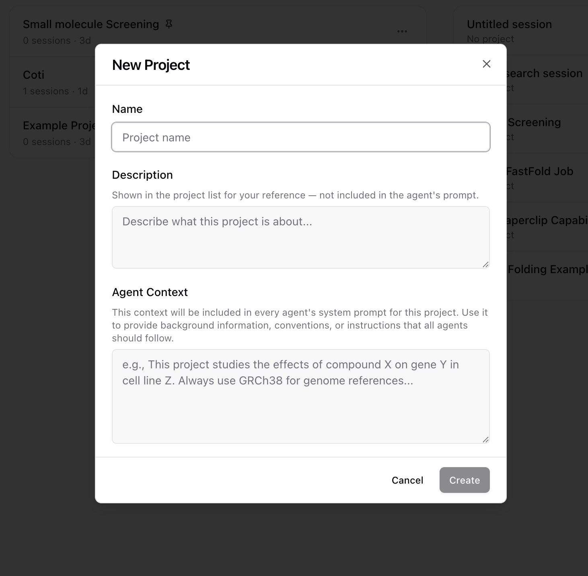
  </picture>
</p>

### Composer

The composer drives every turn: model and effort, specialist, sandbox, plus `@` files and `/` skills & MCPs.

**Model.** Pick a frontier or local model, set Low / Medium / High effort, and optionally enable Fast.

<p align="center">
  <picture>
    <source media="(prefers-color-scheme: dark)" srcset="images/showcase-composer-models-dark.png">
    <source media="(prefers-color-scheme: light)" srcset="images/showcase-composer-models-light.png">
    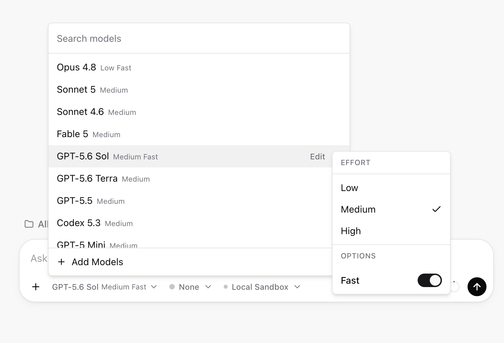
  </picture>
</p>

**Specialist.** Load a skill + MCP + instruction pack (genomics, MD, protein design, …) or define your own.

<p align="center">
  <picture>
    <source media="(prefers-color-scheme: dark)" srcset="images/showcase-composer-specialist-dark.png">
    <source media="(prefers-color-scheme: light)" srcset="images/showcase-composer-specialist-light.png">
    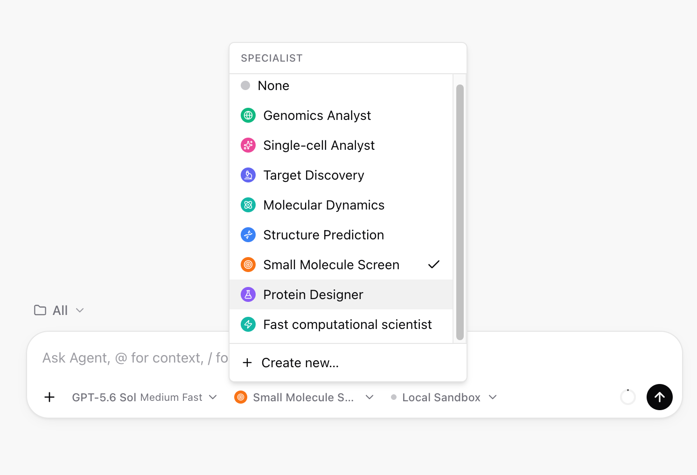
  </picture>
</p>

**Sandbox.** Stay on Local Sandbox (live chip / RAM / GPU specs) or switch to Modal for cloud CPU/GPU.

<p align="center">
  <picture>
    <source media="(prefers-color-scheme: dark)" srcset="images/showcase-composer-sandbox-dark.png">
    <source media="(prefers-color-scheme: light)" srcset="images/showcase-composer-sandbox-light.png">
    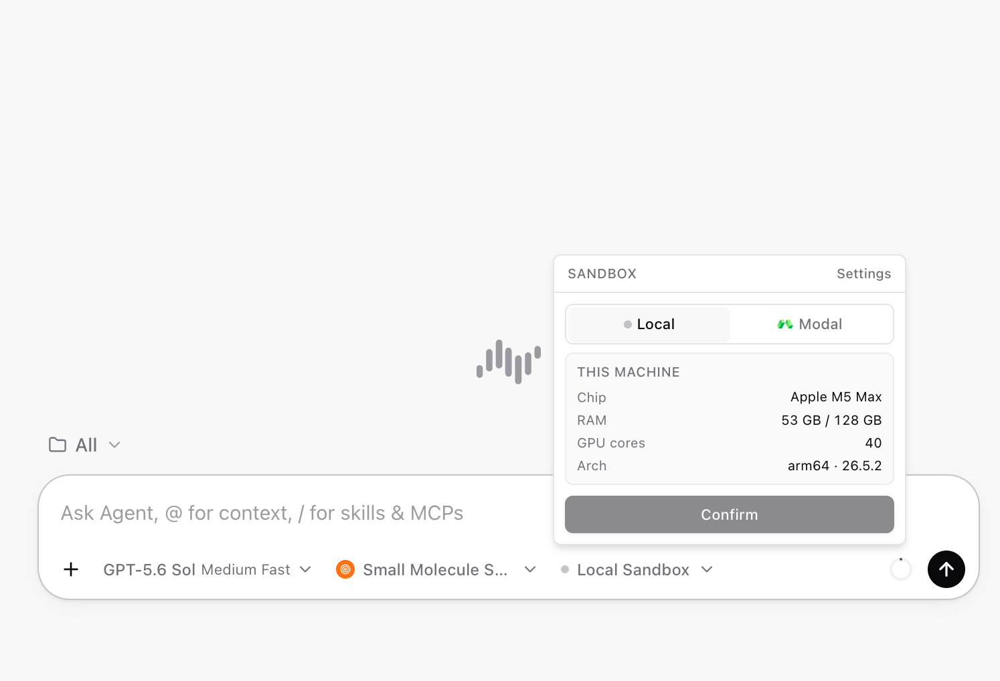
  </picture>
</p>

**Plan mode.** Switch the composer from **Agent** to **Plan** when you want a campaign design first. The agent writes `plans/<slug>.md` (steps + Mermaid), fills todos, and surfaces a **Build** action with no Y/n gate. Edit in chat, then Build or flip back to Agent. In the CLI: `/plan` (sessions start in Agent mode; the status bar shows plan mode only when on).

<p align="center">
  <picture>
    <source media="(prefers-color-scheme: dark)" srcset="images/showcase-plan-mode-dark.png">
    <source media="(prefers-color-scheme: light)" srcset="images/showcase-plan-mode-light.png">
    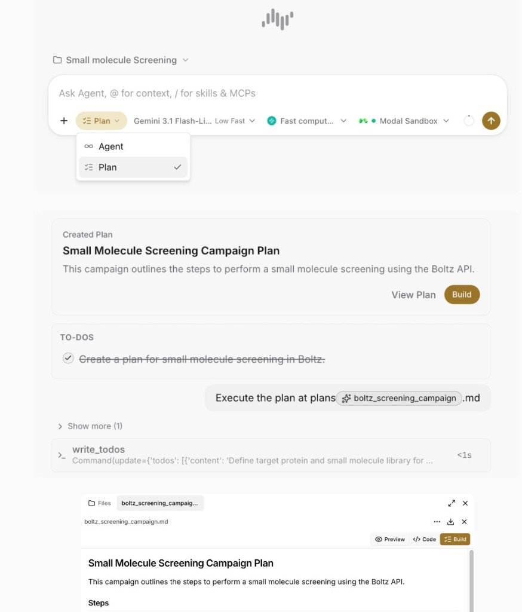
  </picture>
</p>

**Multimodal.** `@`-attach workspace files in the same composer. Gemini models accept image, PDF, audio, and video natively; Dashboard → **Models** → **Multimodal support** lists what each model can take.

### Skills and MCPs

Type `/` in chat to browse skills and MCPs for the active specialist. Open a skill for docs and **Try** example prompts without leaving the thread.

<p align="center">
  <picture>
    <source media="(prefers-color-scheme: dark)" srcset="images/showcase-skills-mcps-picker-dark.png">
    <source media="(prefers-color-scheme: light)" srcset="images/showcase-skills-mcps-picker-light.png">
    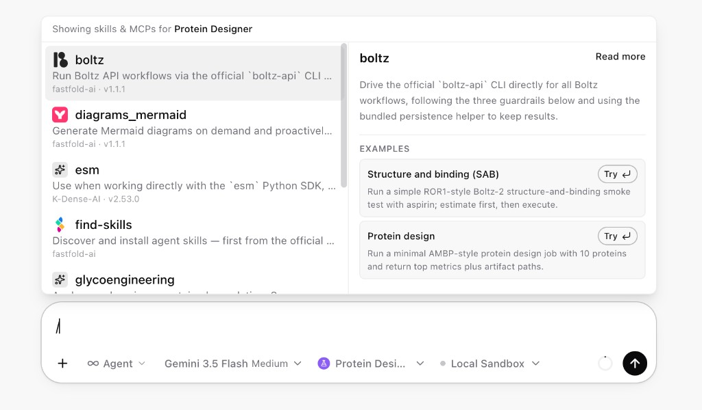
  </picture>
</p>

Manage those servers under Dashboard → **MCPs**: toggle catalog entries, connect when auth is required, or add a custom URL. Credentials live under Integrations / keys.

<p align="center">
  <picture>
    <source media="(prefers-color-scheme: dark)" srcset="images/showcase-mcp-servers-dark.png">
    <source media="(prefers-color-scheme: light)" srcset="images/showcase-mcp-servers-light.png">
    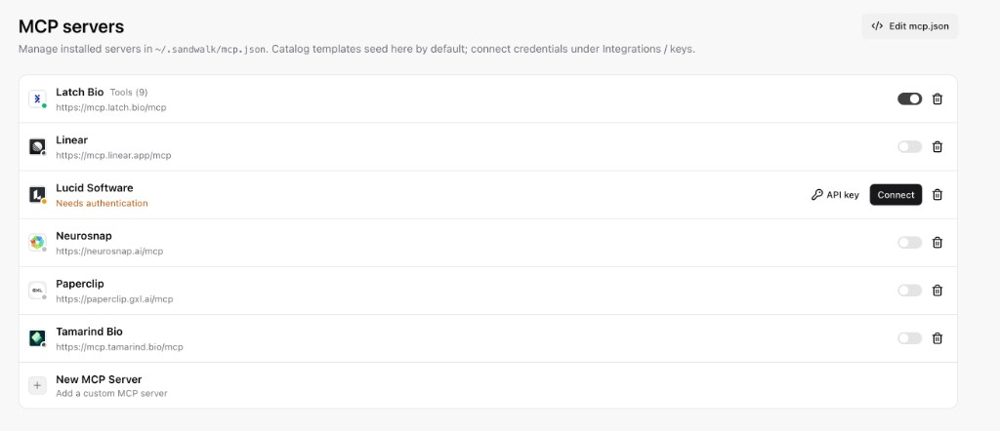
  </picture>
</p>

Config is stored as standard `mcpServers` JSON in `~/.sandwalk/mcp.json`, the same shape Cursor and other MCP clients use. Edit from **Edit mcp.json** and **Save MCPs**, or hand-edit the file.

<p align="center">
  <picture>
    <source media="(prefers-color-scheme: dark)" srcset="images/showcase-mcp-json-dark.png">
    <source media="(prefers-color-scheme: light)" srcset="images/showcase-mcp-json-light.png">
    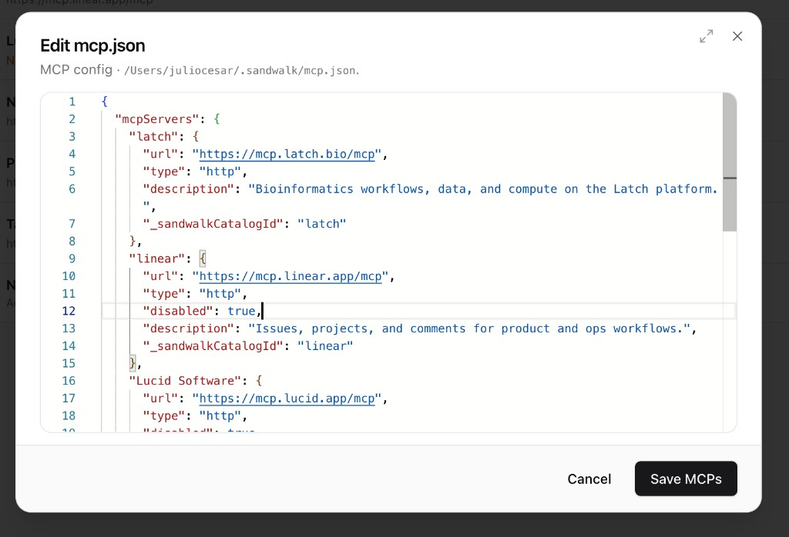
  </picture>
</p>

For packaged workflows, open Dashboard → **Skills**. Toggle **Skills.sh** to search the [skills.sh](https://skills.sh) registry (results show install counts), or import from GitHub (`owner/repo`, `owner/repo@path`, or a URL, same as `sandwalk skills add`).

<p align="center">
  <picture>
    <source media="(prefers-color-scheme: dark)" srcset="images/showcase-skills-sh-dark.png">
    <source media="(prefers-color-scheme: light)" srcset="images/showcase-skills-sh-light.png">
    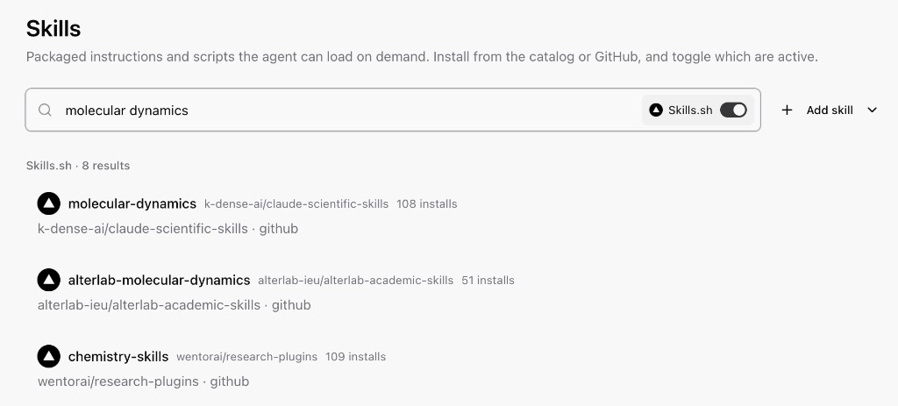
  </picture>
</p>

Open a skill for the install command, enable/disable toggle, links to Skills.sh and GitHub, plus install count and security audit badges (Socket, Snyk, and others).

<p align="center">
  <picture>
    <source media="(prefers-color-scheme: dark)" srcset="images/showcase-skills-manage-dark.png">
    <source media="(prefers-color-scheme: light)" srcset="images/showcase-skills-manage-light.png">
    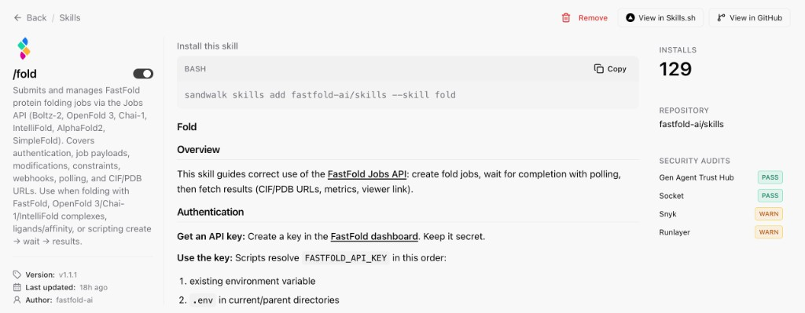
  </picture>
</p>

### Artifacts and terminal

When the agent produces structures, plots, or reports, open them in **Artifacts** beside the chat: JSON, SVG (PAE, pLDDT), and CIF/PDB in a 3D viewer.

<p align="center">
  <picture>
    <source media="(prefers-color-scheme: dark)" srcset="images/showcase-artifacts-dark.png">
    <source media="(prefers-color-scheme: light)" srcset="images/showcase-artifacts-light.png">
    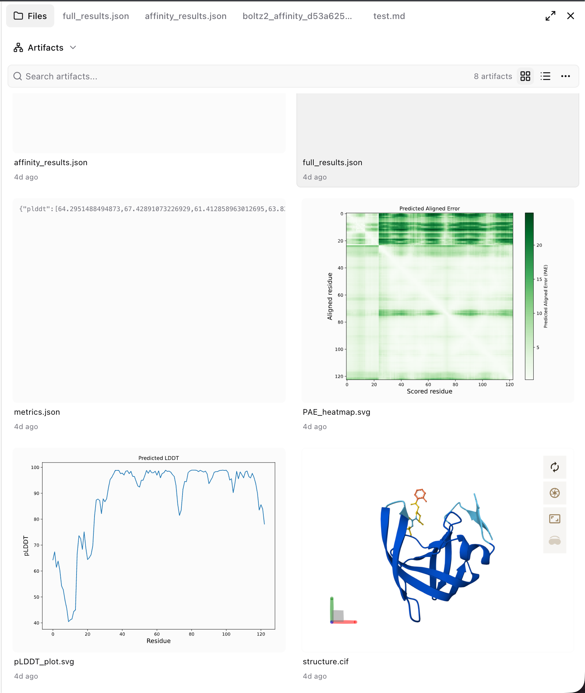
  </picture>
</p>

Below the workspace, a multi-tab terminal follows your theme. The CLI tab mirrors interactive `sandwalk` (`/` autocomplete; status bar shows model, specialist, sandbox, cwd, and context usage).

<p align="center">
  <picture>
    <source media="(prefers-color-scheme: dark)" srcset="images/showcase-terminal-dark.png">
    <source media="(prefers-color-scheme: light)" srcset="images/showcase-terminal-light.png">
    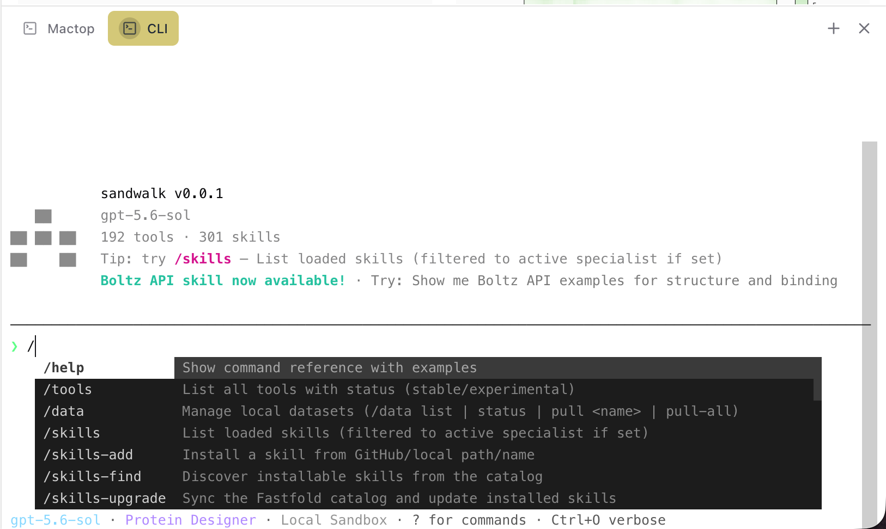
  </picture>
</p>

### Sidebar

| Area | What you configure |
|------|--------------------|
| **Models** | Cloud providers and local OpenAI-compatible endpoints |
| **Tools** | Browse and enable curated tools; install more anytime |
| **Skills / MCPs** | Installs, skills.sh, GitHub import, `mcp.json` |
| **Datasets** | Local corpora (DepMap, PRISM, L1000, …) |
| **Specialists** | Skill + MCP + instruction packs |
| **Integrations** | Modal, Boltz, Fastfold Cloud, LangSmith, Tavily, Slack, … |
| **Runtime** | Defaults, prompts, sandbox, doctor, storage, env |
| **Server** | Bind, auth (`sandwalk auth`), logs |

## Usage

```bash
sandwalk "What is known about KRAS G12C inhibitors?"
sandwalk --smiles "CCO" "Profile this compound"
sandwalk                 # interactive; /sandbox picker, /plan (starts off)
sandwalk serve           # dashboard at http://127.0.0.1:8969
```

```bash
sandwalk config show|set <key> <value>
sandwalk tool list
sandwalk skills list
sandwalk mcp list
sandwalk data list
sandwalk doctor
sandwalk --help
```

Interactive highlights: `/model`, `/sandbox` (Local / Modal presets + base image), `/plan`, `/usage`. See [`cli/README.md`](cli/README.md) and the [CLI docs](https://docs.sandwalk.ai/cli/terminal) (or `docs/content/cli/`).

Config and data live under `~/.sandwalk/` (legacy `~/.fastfold-cli/` / `~/.ct/` are copied once if present). On macOS, Sandwalk.app also stores server settings in Application Support.

## Documentation

Product docs (Fumadocs, same stack as Fastfold Cloud docs) live in [`docs/`](docs/):

```bash
pnpm install
pnpm dev:docs    # http://localhost:3001
```

Contributor / CI testing notes: [`.github/TESTING.md`](.github/TESTING.md).

## License

Apache License 2.0. Copyright © 2026 Fastfold AI Labs. See [LICENSE](LICENSE).

## Contributing / from source

Monorepo: `cli/`, `apps/local-web/`, `apps/sandwalk-mac/`. Day-to-day use the install options above; to hack on the repo see [CONTRIBUTING.md](CONTRIBUTING.md).

```bash
pnpm install
cd cli && uv sync && uv run sandwalk serve   # CLI + agent server
# cd cli && uv sync --extra all              # optional science stacks
# another terminal: pnpm dev
# or on macOS: cd apps/sandwalk-mac && swift run
```

`uv sync` installs the CLI, Local Sandbox, and agent server. `--extra all` adds chemistry / single-cell / ML / DuckDB.

```bash
cd cli && uv run ruff check src && uv run mypy
pnpm --filter @sandwalk/agent-local-web lint:check
pnpm --filter @sandwalk/agent-local-web build

pnpm test:coverage       # Local Web UI
pnpm test:cli:coverage   # Agent CLI + Agent Server
pnpm test:mac            # Mac app (Xcode required)
```

Coverage gate is **≥80%** per component; CI uploads to [Codecov](https://app.codecov.io/gh/fastfold-ai/sandwalk). Full guide: [`.github/TESTING.md`](.github/TESTING.md). Package notes: `apps/sandwalk-mac/README.md`, `cli/README.md`.
