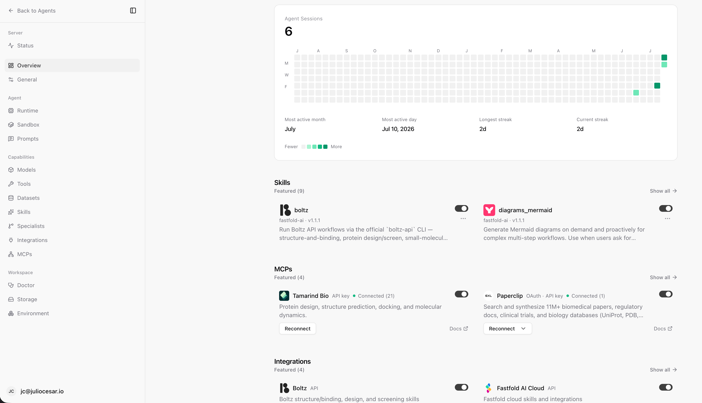
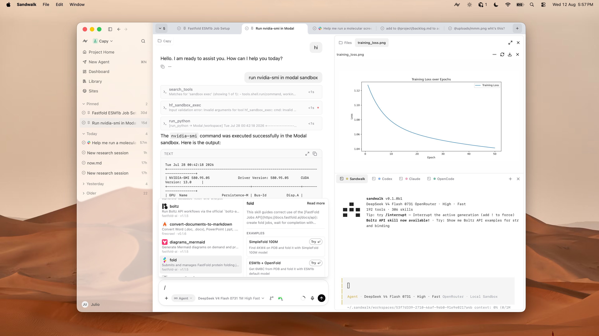

<h1 align="center">Sandwalk Web Dashboard</h1>

<p align="center">
  <picture>
    <source media="(prefers-color-scheme: dark)" srcset="public/brand/sandwalk-logo-dark.svg">
    <source media="(prefers-color-scheme: light)" srcset="public/brand/sandwalk-logo-light.svg">
    
  </picture>
</p>

<p align="center">
React dashboard for the local Sandwalk agent server — chat, projects, viewers,
skills, MCPs, specialists, and terminal in one place. Shares agent sessions with
the CLI and the macOS app.
</p>

<p align="center">
  <picture>
    <source media="(prefers-color-scheme: dark)" srcset="../../images/showcase-web-dark.png">
    <source media="(prefers-color-scheme: light)" srcset="../../images/showcase-web-light.png">
    
  </picture>
</p>

| Service | Default URL |
|---------|-------------|
| **Dashboard** (this app) | http://127.0.0.1:8969 |
| **Agent API** | http://127.0.0.1:8787 |

## What it does

- **Overview** — session activity heatmap, streaks, featured skills / MCPs / integrations
- **Projects** — scoped workspaces with name, description, and agent context
- **Composer** — models / effort / fast mode, specialists, sandbox (local or Modal), `@` files and `/` skills
- **Artifacts & viewers** — structures (Mol*), plots, PAE / pLDDT, and result grids
- **Terminal** — CLI in the browser with slash-command autocomplete
- **Settings** — models, tools, datasets, skills, specialists, integrations, MCPs, runtime, sandbox

Same sessions as `sandwalk` in the terminal and as **Open Web Dashboard** from Sandwalk.app.

<p align="center">
  <picture>
    <source media="(prefers-color-scheme: dark)" srcset="../../images/showcase-dark.png">
    <source media="(prefers-color-scheme: light)" srcset="../../images/showcase-light.png">
    
  </picture>
</p>

## Prerequisites

- Node 22+ and [pnpm](https://pnpm.io/) 10.x
- A running agent API on `127.0.0.1:8787` (`sandwalk serve`, Sandwalk.app, or CLI from `cli/`)

## Run (development)

From the monorepo root:

```bash
pnpm install
pnpm dev
# or: pnpm --filter @sandwalk/agent-local-web dev
```

Opens http://127.0.0.1:8969 (Vite). Expects the agent API on http://127.0.0.1:8787.

If you use **Sandwalk.app** in Development mode, let the Mac app supervise Vite — do not also run `pnpm dev` in another terminal (port conflict).

## Build & preview

```bash
pnpm --filter @sandwalk/agent-local-web build
pnpm --filter @sandwalk/agent-local-web preview
```

Production builds are also served by the agent API when the stack runs in **Production** mode (Mac app Advanced settings, or `sandwalk serve` with built UI).

## Project layout

```
apps/local-web/
├── package.json                 # @sandwalk/agent-local-web
├── vite.config.ts               # Dev server on :8969
├── vitest.config.ts             # Coverage include set + 80% gate
├── eslint.config.js             # max-lines 300 + import rules
├── public/brand/                # Logos and mark
└── src/
    ├── App.tsx / main.tsx
    ├── components/              # Shell, agents, UI primitives
    ├── hooks/
    └── lib/                     # Pure helpers (preferred for unit tests)
```

Workspace packages used by this app: `@sandwalk/agent-local-client`, `@sandwalk/agent-ui-core`.

## File length rules

- **Max 300 lines** per `.ts` / `.tsx` file (`skipBlankLines` + `skipComments`)
- Test files (`*.test.ts` / `*.test.tsx`) are excluded
- Prefer extracting hooks, parts, and helpers into sibling modules over growing a component past 300

```bash
pnpm --filter @sandwalk/agent-local-web lint:check
```

## Lint, format & typecheck

```bash
# from monorepo root
pnpm --filter @sandwalk/agent-local-web lint:check
pnpm --filter @sandwalk/agent-local-web format:check
pnpm --filter @sandwalk/agent-local-web typecheck

# autofix
pnpm --filter @sandwalk/agent-local-web lint
pnpm --filter @sandwalk/agent-local-web format
```

## Tests & coverage

Vitest + jsdom. Coverage gate is **≥80%** on a scoped include set (pure / unit-testable modules):

```bash
pnpm test                 # from monorepo root
pnpm test:coverage        # writes apps/local-web/coverage/
# or:
pnpm --filter @sandwalk/agent-local-web test
pnpm --filter @sandwalk/agent-local-web test:coverage
```

Included in the gate (`vitest.config.ts`):

- `src/components/agents/transcript.ts`
- `src/components/agents/composer-parts.ts`
- `src/components/agents/skill-examples.ts`
- `src/lib/**` (minus a few large untested modules listed in `exclude`)

Reports:

- Terminal summary
- `coverage/lcov.info` — Codecov flag `local-web`
- `coverage/index.html` — open locally after `test:coverage`

```bash
open apps/local-web/coverage/index.html
```

Full monorepo testing guide: [docs/TESTING.md](../../docs/TESTING.md).

## Contributing

This package lives in the [sandwalk](https://github.com/fastfold-ai/sandwalk) monorepo
(`cli/`, `apps/local-web/`, `apps/sandwalk-mac/`). See [CONTRIBUTING.md](../../CONTRIBUTING.md)
for repo-wide setup.

When changing the web dashboard:

1. Keep `.ts` / `.tsx` sources under **300 lines** (`lint:check`)
2. Prefer pure helpers in `src/lib/` (and small agent modules) so they can join the coverage gate
3. Add / update Vitest coverage for modules you touch; keep the scoped gate ≥80%
4. Run before opening a PR:

```bash
pnpm --filter @sandwalk/agent-local-web lint:check
pnpm --filter @sandwalk/agent-local-web typecheck
pnpm --filter @sandwalk/agent-local-web test:coverage
pnpm --filter @sandwalk/agent-local-web build
```

5. Keep PRs focused; do not commit `dist/`, `coverage/`, secrets, or local `.env` files
6. CI runs lint, typecheck, build, and tests on every PR (Codecov flag `local-web`)

Handy commands from the monorepo root:

| Command | Purpose |
|---------|---------|
| `pnpm dev` | Vite dashboard on :8969 |
| `pnpm test` / `pnpm test:coverage` | Vitest (+ coverage gate) |
| `pnpm --filter @sandwalk/agent-local-web lint:check` | ESLint including `max-lines` |
| `pnpm --filter @sandwalk/agent-local-web build` | `tsc -b` + Vite production build |
