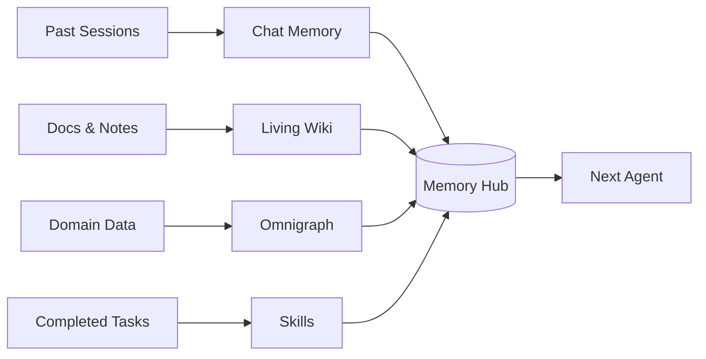

Sandwalk turns everyday sessions into a structured, self-improving local knowledge base under `~/.sandwalk/memory/`—without requiring external database infrastructure or bloating your system prompt.

## The Four Knowledge Assets

| Asset | On-Disk Location | Purpose |
|---|---|---|
| **1. Bounded Snapshots (`USER.md`, `MEMORY.md`, `PRIORS.md`)** | `~/.sandwalk/memory/USER.md` `~/.sandwalk/memory/MEMORY.md` `~/.sandwalk/memory/specialists/<slug>/MEMORY.md` | Compact, high-signal user preferences (~1,375 chars) and workspace/specialist rules (~2,200 chars) injected and frozen at session start so LLM KV prefix caches remain byte-stable. |
| **2. Living Markdown Wiki (`[[wikilinks]]`)** | `~/.sandwalk/memory/wiki/<scope>/*.md` | Multi-paragraph Markdown syntheses, target dossiers, and architecture notes with automatic `[[wikilink]]` and backlink indexing, live **Preview / Split / Edit** modes, and **Full Screen** editing. |
| **3. Local Omnigraph Knowledge Graph (`.omni`)** | `~/.sandwalk/memory/omni/<scope>/graph.omni` `schema.pg` · `queries.gq` · `data.jsonl` · `SKILL.md` | Versioned Rust + Lance graph engine ([omnigraph.dev](https://www.omnigraph.dev/)) with 6 runnable Cookbook Modes (`01–06`), `Supports` vs. `Contradicts` provenance edges, and Git-style `review/*` branches. |
| **4. Crystallized Skills (`SKILL.md`)** | `~/.sandwalk/skills/<slug>/SKILL.md` `references/{schema.pg,queries.gq,wiki-digest.md}` | Verified domain rules, Living Wiki syntheses, and Omnigraph ontologies packaged into an executable `/skill-slug` that any agent or Specialist can invoke. |

---

## Scopes & Specialist Brains

Every memory entry, Wiki page, and Knowledge Graph is scoped to one of four namespaces:

1. **`global` (Global Brain — Personal & Lab)**: Defaults to **`06 Second brain`** (`Person`, `Organization`, `Note`, `Artifact`, `Goal`, `Project`, `Task`).
2. **`project:<id>` (Project Brain)**: Scoped to a specific Sandwalk Project.
3. **`specialist:<id>` (Specialist Brain)**: Each Specialist—whether one of the starter O'Reilly animal personas (**Otium**, **Atlas**, **Nova**, **Milo**, **Soren**), a scientific specialist, or a custom profile you create via **`+ New specialist`**—has its own `PRIORS.md`, `MEMORY.md`, default model, and Cookbook ontology lens.
4. **`user` (`USER.md` Profile)**: Your personal preferences, stack, and communication style across all sessions.

---

## Six Runnable Omnigraph Cookbook Modes (`01–06`)

Sandwalk ships with six runnable [Omnigraph](https://www.omnigraph.dev/) Cookbooks. Each Cookbook defines a 3-layer `.pg` ontology schema, linted `.gq` stored queries, and a starter graph seed:

| Mode | Focus | Core Node Types |
|---|---|---|
| **`01 Industry intel`** | Track AI/ML and market signals through the SPIKE framework | `Element`, `SourceArtifact`, `Signal`, `Pattern`, `Insight`, `KnowHow` |
| **`02 Pharma intel`** | Monitor compounds, mechanisms, clinical trials, and thesis assumptions | `Compound`, `Mechanism`, `Trial`, `Company`, `Signal`, `Pattern`, `Insight`, `Program`, `Assumption`, `Decision`, `OpenQuestion` |
| **`03 Context graph`** | Model organizational decisions, traces, actors, and action items | `Actor`, `Artifact`, `Claim`, `Decision`, `ActionItem` |
| **`04 VC OS`** | Connect deal flow, investment beliefs, founders, and portfolio signals | `Company`, `Founder`, `Deal`, `Signal`, `InvestmentBelief`, `FollowUp` |
| **`05 Biomed research`** | Track targets, papers, assays, hypotheses, and supporting/contradicting evidence | `Entity`, `Paper`, `AssayResult`, `Hypothesis`, `Claim` |
| **`06 Second brain`** | Personal operating graph for people, notes, goals, projects, and tasks | `Person`, `Organization`, `Note`, `Artifact`, `Goal`, `Project`, `Task` |

---

## Automatic Build-Up & Conversational Management

Knowledge builds up both **automatically** as you work and **on command** through any chat agent or **Capy**:

- **Automatic Post-Run Distillation**: When a substantive chat turn completes (`run.completed`) and `memory.distiller.mode` is `hybrid` (default) or `auto`, Sandwalk spawns a background daemon thread (`_auto_distill_after_run`) that extracts high-signal conclusions, decisions, and supporting/contradicting claims into `MEMORY.md`, a Living Wiki page, and the `.omni` Knowledge Graph. If your local `llama.cpp` GPU is busy, distillation automatically defers.
- **Always-On Core Agent Tools (`memory.*`)**:
  - `memory.mutate` — Add, patch, or remove entries in `USER.md`, `MEMORY.md`, or `PRIORS.md`.
  - `memory.session_search` — Full-text search (SQLite FTS5) across past session transcripts.
  - `memory.wiki_list`, `memory.wiki_read`, `memory.wiki_write` — Read and write Living Wiki `.md` pages with `[[wikilinks]]`.
  - `memory.select_cookbook`, `memory.graph_upsert_node`, `memory.graph_record_claim`, `memory.graph_cookbook_query`, `memory.graph_branch` — Query or mutate the Omnigraph and manage `review/*` branches.
  - `memory.distill_session` — Distill any session on demand.
  - `memory.create_skill` — Crystallize a scope's Memories, Living Wiki pages, and Omnigraph Ontology into an installed Sandwalk Skill (`~/.sandwalk/skills/<slug>/SKILL.md`).
- **Capy Meta-Agent Tools (`capy.*`)**:
  - `capy.memory_manage`, `capy.memory_search`, `capy.wiki_digest`, `capy.distill_session`, and `capy.create_skill_from_memory`.
